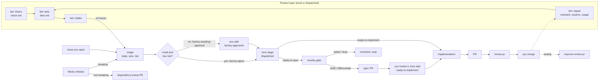

# factory

A cloud software factory for small, pre-revenue projects. It is a set of Claude Code skills and GitHub Actions workflows that move work from a product bet to a reviewed pull request. Agents advance small, low-risk work on their own, and a human approves anything critical or complex.

## Where it stands

0.2 is built on a branch and not yet released; 0.1.0 is the current release. In 0.1 the factory is copied into each repository: `scripts/install-factory.sh` puts the skills in `.claude/skills/` and the workflows in `.github/workflows/`, and every factory change needs a reinstall and a PR in each repository. That copy mode still works.

In 0.2 each repository holds one small generated stub per stage. A stub calls the factory's reusable workflow, `stage.yml`, at a release line such as `@v0.2`. `stage.yml` reads `pipeline.yaml` (the stages, tiers, tools and autonomy rules as data), the repository's `.github/factory/config.yml` and its Actions variables, and resolves a plan. Then three jobs run: plan, agent (read-only, no write token) and apply (the only job that writes). New behavior ships behind the flags in `features.yaml`, and a run opens a `factory:update` issue when a newer version or an undecided flag exists. `scripts/factory` gained `install`, `update`, `tracker` and `materialize`, and `doctor` checks the new setup.

Not built yet: `contract.lock` and its lint, the announce window for flags (there are two flag states, `preview` and `default`, and a repository opt-out), the agent-driven update stage (a human runs `factory update`), `factory try`, the `cloud` runtime, a second tracker adapter and the single-stub option. Nothing has run from `@main` yet; the test repository is converted on a branch. Repositories still on 0.1 follow [MIGRATION.md](MIGRATION.md). The design is in [docs/rollout.md](docs/rollout.md) (distribution, versions, flags, update issues), [docs/pipeline.md](docs/pipeline.md) (the stage runner) and [docs/architecture.md](docs/architecture.md) (diagrams).

It is a port of [warpdotdev-demos/cloud-factory-demo](https://github.com/warpdotdev-demos/cloud-factory-demo) from Warp's Oz runtime to [`anthropics/claude-code-action`](https://github.com/anthropics/claude-code-action). It adds a product layer (`bet`), a prior-art gate (`novelty-gate`), risk-based autonomy, model tiers chosen for cost, and automatic dependency bumps between repositories.

## The problem it solves

One person with a handful of small repositories has more fixable issues than hours. Most of them are small and low-risk: a typo, a failing check, a bump, a contained feature. A few touch things that must not break: invariants, schemas, auth, data. Running an agent on everything is reckless; approving every step by hand costs the time it was meant to save.

The factory draws that line per issue. Triage decides what an issue is (state), how big it is (size) and what it touches (risk), from the repository's own `FACTORY.md`. Small, low-risk work goes through spec, implementation and review without you; everything else waits for one label from you. Every stage runs as a GitHub Actions job on the repository's own secrets, writes only through pull requests, and ends in a review a human merges. The diagram below is that path.

## Flow



### Who advances an issue

Triage returns a state (`ready-to-implement`, `ready-to-spec`, `needs-info`, `wait-to-implement`), a size, any risk labels, and an autonomy decision. Agents advance an issue only when:

- it is `ready-to-implement` and `small`, or `ready-to-spec` and at most `medium`
- it has no `invariant-risk` label
- it touches nothing listed under **Protected paths** or **Human-only** in `FACTORY.md`
- it involves no consumer-facing API, schema, migration, data deletion, auth, secrets or sensitive data
- automated checks can validate it

Such issues get `factory:agent`, and the next stage is dispatched immediately. Everything else gets `factory:awaiting-approval`, and you add `factory:approved` to start it. The `autonomy` key in `config.yml` (or the `FACTORY_AUTONOMY` variable, which wins) can tighten this further: `standard` follows triage, `small` lets agents advance only small issues, and `off` makes humans advance everything.

Some steps are always human: approving a spec (by adding `ready-to-implement`), merging, and adopting a breaking dependency release. Agents never push to the default branch.

### Who enforces a rule: your version-control host, or the factory

The factory's guarantees come in two kinds. They protect against different things, so each rule here should say which kind it is.

- **Host-enforced.** The version-control host checks the rule on every change, whoever makes it: you, a collaborator, or the factory. It holds even if the factory has a bug. On GitHub this means rulesets and branch protection. Examples:
  - The factory's `v*` tags can be moved only by its release workflow (`scripts/factory protect`).
  - A repository's default branch can require a pull request and block force pushes (`doctor --protect-default-branch`).

  On a private repository, GitHub needs Pro or Team for these; other hosts have their own equivalents and plans.
- **Factory-enforced.** The factory checks before it acts, so the rule binds only what the factory itself does. Examples:
  - triage's autonomy rules, and the Protected-paths and Human-only gates in `FACTORY.md`;
  - the read-only agent job, with only the apply job able to write;
  - auto-merge's `factory` mode ([docs/auto-merge.md](docs/auto-merge.md)).

  You can still do any of these things by hand. Nothing on the host stops a factory bug from breaking such a rule, so factory-enforced rules fail closed on missing information, are covered by tests, and new ones start behind a preview flag or in shadow mode.

Prefer host enforcement where your host and plan offer it. Where they don't, a factory-enforced rule is still worth having, as long as it's documented as one: auto-merge offers both modes for this reason ([Two enforcement modes](docs/auto-merge.md#two-enforcement-modes)).

## Models and cost

| Stage | Default model | When it's bigger |
|---|---|---|
| Triage | Haiku 5.5 | High effort for invariant-heavy or sensitive repositories. On four test cases from an invariant-heavy library it made the same safety calls as Sonnet 5.5, at about a tenth of the cost |
| Implement | Haiku 5.5 for `factory:agent` issues | Sonnet 5.5 when a human approved it; Opus 5.5 (high effort) for `invariant-risk` |
| Review | Haiku 5.5 for PRs of ≤400 changed lines | Sonnet 5.5 for larger PRs or `invariant-risk` |
| Spec | Sonnet 5.5 | Opus 5.5 (high effort) for `invariant-risk` |
| Dependency bump | Haiku 5.5 | none; breaking releases go to a human instead |
| Bet intake, improve review | Sonnet 5.5 | none |

Effort is `medium` unless noted, set with `CLAUDE_CODE_EFFORT_LEVEL`. Every model and effort level can be set per stage in `.github/factory/config.yml` (`stages.<stage>.tier`, a tier name `fast`, `balanced` or `deep`, or a model ID, and `stages.<stage>.effort`). Repository variables (`FACTORY_MODEL_*`, `FACTORY_EFFORT_*`) still work and take precedence.

Other cost limits:

- triage only runs on collaborators' issues
- every stage has `--max-turns` and a job timeout
- the improve-review loop runs weekly and skips the agent when there's no feedback
- bet intake creates at most 3 issues per run
- review skips drafts and release-please PRs

Commits name the model that made them, for example `Co-Authored-By: Claude Haiku 5.5 <noreply@anthropic.com>`.

## Skills

| Skill | Stage | Origin |
|---|---|---|
| `bet` | Product layer: thesis (`vision.md`), bets (`bets.md`), intake (drafts issues), signal (evidence log) | New |
| `triage` | Picks the state, size, risk and autonomy | Ported, extended |
| `novelty-gate` | Decides build, differentiate, adopt or drop before any spec; writes `PRIOR_ART.md` | New |
| `spec` | Novelty gate, then PRODUCT.md and TECH.md in a specs PR | Ported |
| `write-product-spec`, `write-tech-spec` | Spec content | Vendored from [warpdotdev/common-skills](https://github.com/warpdotdev/common-skills) and made generic |
| `implementation` | Implements, validates, verifies, opens a PR | Ported |
| `validate-against-specs` | Non-interactive spec-alignment report | New |
| `verify-behavior` | Screenshot evidence for UI changes: Playwright MCP in CI, gstack `/browse` locally | Rewritten |
| `review-pr` | Writes `review.json`; a separate job publishes it | Ported, with scripts |
| `improve-review-pr` | Outer loop that learns from your reactions to reviews | Ported, with collector |
| `dependency-bump` | Moves a pin to a new non-breaking release of an internal library | New |
| `factory-setup` | None: a person runs it (`/factory-setup`) to install, migrate or update the factory in a repository and draft `FACTORY.md` and `config.yml`; stages never load it | New |

## Workflows

Each repository has one generated stub per stage in `.github/workflows/`, written by `factory install`. A stub holds the triggers, concurrency, permission ceiling and the version it calls (`uses: <owner>/factory/.github/workflows/stage.yml@v0.2`); everything else is in `pipeline.yaml`. The agent jobs run `anthropics/claude-code-action@v1.0.245`. These are the stages and their triggers:

| Stage | Trigger |
|---|---|
| `triage` | issue opened by an owner, member or collaborator; dispatch |
| `spec` | `ready-to-spec` added by a human, `factory:approved` on a `ready-to-spec` issue, or dispatch |
| `implement` | `ready-to-implement` added by a human, `factory:approved` on a `ready-to-implement` issue, or dispatch |
| `review` | PR opened or updated (`pull_request_target`, trusted-base checkout); dispatch |
| `improve-review` | weekly; dispatch |
| `bet-intake` | dispatch |
| `dependency-bump` | `repository_dispatch` from a library release; dispatch |
| `notify-consumers` | called from a library's release-please workflow after publishing |

The `local` runtime of `stage.yml` (the `local session` job) starts a background Claude Code session on a self-hosted machine for spec and implement. `factory:local` on an issue picks it, or `stages.<stage>.runtime: local` picks it for every issue ([docs/local-runner.md](docs/local-runner.md)). The 0.1 workflows are still in `templates/github/workflows/` for copy mode, including `factory-local.yml`.

## Versions

Releases come from [release-please](https://github.com/googleapis/release-please) and conventional PR titles, which a CI check enforces. Before 1.0, the minor number is the breaking-change number: `fix:` and `feat:` cut a patch release (new behavior ships behind a flag), and `feat!:` cuts the next minor line. Each release moves its line tag (`v0.1`, `v0.2`, …), which repositories call through their stubs ([docs/rollout.md](docs/rollout.md) §2). 0.1.0, the installer-based factory, is released. The reusable workflows ship as 0.2.0 (`feat(pipeline)!:`). Merge the open release PR to release. To roll back, dispatch the Release workflow with `rollback: v0.2.3`.

## Set up a repository

The short path. [docs/setup.md](docs/setup.md) has the details and the manual equivalents. To have an agent walk you through it, start a session at the repository's root and ask it to follow `~/code/factory/skills/factory-setup/SKILL.md`; once installed, the repository has it as `/factory-setup` for migrations and updates.

1. **Install the stubs**, from the root of the repository, on a new branch:

   ```bash
   ~/code/factory/scripts/factory install
   ```

   It writes a stub per stage into `.github/workflows/` that calls this factory at the line tag of your checkout (`--ref main` for a repository that should track every merge), plus `.github/factory/config.yml` and `materialize.sh`, a `.gitignore` block, a SessionStart hook in `.claude/settings.json` that fetches the pinned skills, and `FACTORY.md`, `vision.md` and `bets.md` if they're missing. The skills are not committed. `--dry-run` shows what would change; running it again is safe.
2. **Fill in `FACTORY.md`**: validation commands, protected paths, human-only areas, consumers, and how to start the app. Agents read it.
3. **Create the tokens by hand**: a fine-grained `FACTORY_GITHUB_TOKEN` that covers the repositories the factory runs in (never the factory itself), and a Claude credential (`claude setup-token` or an API key). Steps in [docs/setup.md](docs/setup.md#1-create-the-tokens).
4. **Declare the repository a consumer and fix its settings**, from inside it:

   ```bash
   ~/code/factory/scripts/factory doctor --fix
   ```

   It adds the `factory` topic, creates missing labels, and sets Actions to a read-only default token that may create pull requests. Without `--fix` it only reports.
5. **Set the secrets** on every repository with the topic, from anywhere:

   ```bash
   export FACTORY_GITHUB_TOKEN='…' CLAUDE_CODE_OAUTH_TOKEN='…'
   ~/code/factory/scripts/factory rotate-secrets
   ```

   It pipes each exported value to `gh`, writes nothing to disk, and lists the repositories it set. To rotate a token, export the new value and run it again.
6. **Optional:** settings in `.github/factory/config.yml` (autonomy, model tiers, effort, flags, runtime; every key has a default). List it under Protected paths in `FACTORY.md`. Repository variables (`FACTORY_AUTONOMY`, `FACTORY_MODEL_*`, `FACTORY_EFFORT_*`) override it. Also `.github/factory/setup.sh` if agents need toolchains or registry credentials (it receives `GITHUB_PACKAGES_TOKEN`). If setup.sh installs a pinned Bun, it should also run `echo "FACTORY_BUN_PATH=$HOME/.bun/bin/bun" >> "$GITHUB_ENV"`, or the agent runs on the Bun that `claude-code-action` installs for itself.

Commit the installed files and merge. Factory changes then reach the repository through the line its stubs call; a `factory:update` issue says when a newer line or a new flag is waiting, and `factory update --to v0.3` moves the stubs. A repository on 0.1 follows [MIGRATION.md](MIGRATION.md). The 0.1 copy mode (`scripts/install-factory.sh`) still works until phase 2 removes it.

The factory names no other repository. Each repository declares itself with the `factory` topic, and `scripts/factory` finds repositories by it; there is no registry and no infra state. Protect the factory itself once, from inside it, with `scripts/factory protect` (rulesets on `main` and `v*` tags).

### Keeping the factory private

This factory is public: consumers fetch it anonymously and rulesets are free. The same pattern works with a private factory on a plan that allows it:

- **Rulesets on a private repository** need GitHub Pro (personal account) or Team (organization). On Free they return 403, and nothing on the server then stops a release tag from being moved.
- **Calling its reusable workflows** (0.2) needs Settings → Actions → General → Access set to the owner's repositories (`scripts/factory protect` sets it). An organization gets the same setting for its repositories and can make the factory `internal` instead of private.
- **Fetching it in runs** needs `FACTORY_READ_TOKEN` (fine-grained, the factory only, Contents: read) on each consumer, set by `scripts/factory rotate-secrets` and renewed before it expires; `doctor` reports it. An organization can set it once as an organization secret scoped to the consumers, or use a GitHub App installation token instead of a personal token.
- **Interactive sessions** fetch skills with your `gh` login instead of anonymously.

The trade-offs are in [docs/rollout.md](docs/rollout.md#11-public-or-private).

## Layout

| Path | What |
|---|---|
| `pipeline.yaml` | the stages, tiers, tool profiles, labels and autonomy rules |
| `features.yaml` | every flag, with its state |
| `stages/` | one prompt per stage (`stages/<stage>/prompt.md`), with output schemas |
| `runner/` | the plan interpreter, `tracker.py`, `agent_output.py` and `apply.py`, with unit tests and golden plans |
| `.github/workflows/stage.yml` | the reusable workflow every stub calls: plan, agent, apply, and the `local` runtime |
| `.github/actions/prepare` | resolves the plan and the job summary, readies the skills, runs the update check |
| `skills/` | the Claude Code skills, one directory each |
| `templates/repo/` | `FACTORY.md`, `vision.md`, `bets.md`, `config.yml` and `materialize.sh` starting points, and `sync-skills.sh` (skills from other repositories, pinned in a repository's `.agents/skills.lock`; installed by `factory skills add`) |
| `templates/github/workflows/` | the 0.1 workflows that copy mode installs; removed in phase 2 |
| `templates/labels.txt` | the labels `doctor --fix` creates |
| `scripts/` | `factory` (install, update, doctor, rotate-secrets, protect, tracker, skills, materialize), `install-factory.sh` (0.1 copy mode), `check-references.sh` (CI: no references to other repositories) |
| `docs/` | setup, the local runner, and the 0.2 design (rollout, pipeline, architecture) |
| `MIGRATION.md` | what a repository does to move between minor lines |

## Using it locally

The skills are ordinary Claude Code skills:

- `/bet thesis` or `/bet bets` to write or refresh the product layer
- `/novelty-gate idea: …` before starting a new project
- `/triage 12`, `/spec 12`, `/implementation 12` to run a stage by hand

## Differences from the Warp demo

- **Runtime.** `claude-code-action` runs in the job and returns when it finishes, so the demo's Oz polling script is gone. Triage returns `--json-schema` structured output instead of having JSON scraped from a transcript.
- **Autonomy.** Advancement depends on risk and size: agents take small, low-risk work, and humans approve the rest with one label.
- **Product layer.** `vision.md` plus `bets.md` replace `roadmap.md`. Unanchored feature work waits. Maintenance needs no bet.
- **Novelty gate** before every spec.
- **Per-repository config.** `FACTORY.md` holds validation commands, protected paths, human-only areas, consumers, and how to start the app.
- **Cross-repository releases.** A library release notifies its consumers. Non-breaking releases are bumped by Haiku, and breaking ones go to a human.
- **Verification.** Screenshots through Playwright MCP or gstack instead of Oz computer-use video. It is opt-in, for repositories with a UI.
- **Self-declared consumers.** Each repository marks itself with the `factory` topic; `scripts/factory` finds repositories by it to set secrets, and checks and fixes each one's labels, Actions settings and rulesets. No infra state, and the factory lists no repositories.

## Contributing

See [CONTRIBUTING.md](CONTRIBUTING.md) (conventional PR titles, the no-references rule, the local checks) and [SECURITY.md](SECURITY.md) for reporting problems privately.

## License

MIT. Derived from MIT-licensed work by Warp and Denver Technologies, Inc.; see [NOTICE.md](NOTICE.md).
