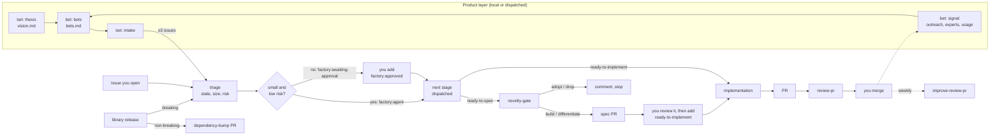

# factory

A cloud software factory for small, pre-revenue projects. It is a set of Claude Code skills and GitHub Actions workflows that move work from a product bet to a reviewed pull request. Agents advance small, low-risk work on their own, and a human approves anything critical or complex.

It is a port of [warpdotdev-demos/cloud-factory-demo](https://github.com/warpdotdev-demos/cloud-factory-demo) from Warp's Oz runtime to [`anthropics/claude-code-action`](https://github.com/anthropics/claude-code-action). It adds a product layer (`bet`), a prior-art gate (`novelty-gate`), risk-based autonomy, model tiers chosen for cost, and automatic dependency bumps between repositories.

## Flow



### Who advances an issue

Triage returns a state (`ready-to-implement`, `ready-to-spec`, `needs-info`, `wait-to-implement`), a size, any risk labels, and an autonomy decision. Agents advance an issue only when:

- it is `ready-to-implement` and `small`, or `ready-to-spec` and at most `medium`
- it has no `invariant-risk` label
- it touches nothing listed under **Protected paths** or **Human-only** in `FACTORY.md`
- it involves no consumer-facing API, schema, migration, data deletion, auth, secrets or sensitive data
- automated checks can validate it

Such issues get `factory:agent`, and the next stage is dispatched immediately. Everything else gets `factory:awaiting-approval`, and you add `factory:approved` to start it. The `FACTORY_AUTONOMY` variable can tighten this further: `standard` follows triage, `small` lets agents advance only small issues, and `off` makes humans advance everything.

Some steps are always human: approving a spec (by adding `ready-to-implement`), merging, and adopting a breaking dependency release. Agents never push to the default branch.

## Models and cost

| Stage | Default model | When it's bigger |
|---|---|---|
| Triage | Haiku 5.5 | High effort for invariant-heavy or sensitive repositories. On four test cases from an invariant-heavy library it made the same safety calls as Sonnet 5.5, at about a tenth of the cost |
| Implement | Haiku 5.5 for `factory:agent` issues | Sonnet 5.5 when a human approved it; Opus 5.5 (high effort) for `invariant-risk` |
| Review | Haiku 5.5 for PRs of ≤400 changed lines | Sonnet 5.5 for larger PRs or `invariant-risk` |
| Spec | Sonnet 5.5 | Opus 5.5 (high effort) for `invariant-risk` |
| Dependency bump | Haiku 5.5 | none; breaking releases go to a human instead |
| Bet intake, improve review | Sonnet 5.5 | none |

Effort is `medium` unless noted, set with `CLAUDE_CODE_EFFORT_LEVEL`. Every model and effort level can be overridden by a repository variable (`FACTORY_MODEL_*`, `FACTORY_EFFORT_*`).

Other cost limits:

- triage only runs on collaborators' issues
- every stage has `--max-turns` and a job timeout
- the improve-review loop runs weekly and skips the agent when there's no feedback
- bet intake creates at most 3 issues per run
- review skips drafts and release-please PRs

Commits name the model that made them, for example `Co-Authored-By: Claude Haiku 5.5 <noreply@anthropic.com>`.

## Skills

| Skill | Stage | Origin |
|---|---|---|
| `bet` | Product layer: thesis (`vision.md`), bets (`bets.md`), intake (drafts issues), signal (evidence log) | New |
| `triage` | Picks the state, size, risk and autonomy | Ported, extended |
| `novelty-gate` | Decides build, differentiate, adopt or drop before any spec; writes `PRIOR_ART.md` | New |
| `spec` | Novelty gate, then PRODUCT.md and TECH.md in a specs PR | Ported |
| `write-product-spec`, `write-tech-spec` | Spec content | Vendored from [warpdotdev/common-skills](https://github.com/warpdotdev/common-skills) and made generic |
| `implementation` | Implements, validates, verifies, opens a PR | Ported |
| `validate-against-specs` | Non-interactive spec-alignment report | New |
| `verify-behavior` | Screenshot evidence for UI changes: Playwright MCP in CI, gstack `/browse` locally | Rewritten |
| `review-pr` | Writes `review.json`; a separate job publishes it | Ported, with scripts |
| `improve-review-pr` | Outer loop that learns from your reactions to reviews | Ported, with collector |
| `dependency-bump` | Moves a pin to a new non-breaking release of an internal library | New |

## Workflows

All of them run `anthropics/claude-code-action@v1.0.245`.

| Workflow | Trigger |
|---|---|
| `factory-triage.yml` | issue opened by an owner, member or collaborator; dispatch |
| `factory-spec.yml` | `ready-to-spec` added by a human, `factory:approved` on a `ready-to-spec` issue, or dispatch |
| `factory-implement.yml` | `ready-to-implement` added by a human, `factory:approved` on a `ready-to-implement` issue, or dispatch |
| `factory-review.yml` | PR opened or updated (`pull_request_target`, trusted-base checkout); dispatch |
| `factory-improve-review.yml` | weekly; dispatch |
| `factory-bet-intake.yml` | dispatch (schedule commented out) |
| `factory-notify-consumers.yml` | called from a library's release-please workflow after publishing |
| `factory-dependency-bump.yml` | `repository_dispatch` from a library release; dispatch |
| `factory-local.yml` | `factory:local` on a `ready-to-implement` or `ready-to-spec` issue; dispatch. Starts a background Claude Code session on a self-hosted machine ([docs/local-runner.md](docs/local-runner.md)) |

## Versions

Releases come from [release-please](https://github.com/googleapis/release-please) and conventional PR titles, which a CI check enforces. Before 1.0, the minor number is the breaking-change number: `fix:` and `feat:` cut a patch release (new behavior ships behind a flag), and `feat!:` cuts the next minor line. Each release moves its line tag (`v0.1`, `v0.2`, …), which repositories will call once the reusable workflows land ([docs/rollout.md](docs/rollout.md) §2). Merge the open release PR to release. To roll back, dispatch the Release workflow with `rollback: v0.2.3`.

## Install into a repository

```bash
cd ~/code/<project>
~/code/factory/scripts/install-factory.sh
```

A proposal to replace per-repository reinstalls with reusable workflows, versioned releases and opt-out feature flags is in [docs/rollout.md](docs/rollout.md) (diagrams in [docs/architecture.md](docs/architecture.md)), and a configuration-driven pipeline (stages, states, model tiers, runtimes) is in [docs/pipeline.md](docs/pipeline.md).

The installer copies the skills into `.claude/skills/` and the workflows into `.github/workflows/`, and creates `FACTORY.md`, `vision.md` and `bets.md` if they're missing. It records checksums in `.claude/factory.lock`, so a reinstall upgrades unchanged files and keeps files you or the improve-review loop changed (`--force` overwrites them). Other options:

- `--with-skills DIR` also copies every skill under `DIR` (each subdirectory with a `SKILL.md`), for example the full novelty-audit skills so the novelty gate can use them in CI
- `--create-labels` creates the labels with `gh` (`scripts/factory doctor --fix` does this too)
- `--dry-run` shows what would change

Then:

1. Fill in `FACTORY.md`: validation commands, protected paths, human-only areas, consumers, and how to start the app.
2. Set up credentials and settings by following [docs/setup.md](docs/setup.md). The fine-grained `FACTORY_GITHUB_TOKEN` is created by hand. Then `scripts/factory doctor --fix`, run inside the repository, declares it a consumer (the `factory` topic) and sets its labels and Actions settings, and `scripts/factory rotate-secrets` sets the secrets on every declared repository. The factory itself names none of them.
3. If agents need toolchains or registry credentials, add `.github/factory/setup.sh` (it receives `GITHUB_PACKAGES_TOKEN`).

## Using it locally

The skills are ordinary Claude Code skills:

- `/bet thesis` or `/bet bets` to write or refresh the product layer
- `/novelty-gate idea: …` before starting a new project
- `/triage 12`, `/spec 12`, `/implementation 12` to run a stage by hand

## Differences from the Warp demo

- **Runtime.** `claude-code-action` runs in the job and returns when it finishes, so the demo's Oz polling script is gone. Triage returns `--json-schema` structured output instead of having JSON scraped from a transcript.
- **Autonomy.** Advancement depends on risk and size: agents take small, low-risk work, and humans approve the rest with one label.
- **Product layer.** `vision.md` plus `bets.md` replace `roadmap.md`. Unanchored feature work waits. Maintenance needs no bet.
- **Novelty gate** before every spec.
- **Per-repository config.** `FACTORY.md` holds validation commands, protected paths, human-only areas, consumers, and how to start the app.
- **Cross-repository releases.** A library release notifies its consumers. Non-breaking releases are bumped by Haiku, and breaking ones go to a human.
- **Verification.** Screenshots through Playwright MCP or gstack instead of Oz computer-use video. It is opt-in, for repositories with a UI.
- **Self-declared consumers.** Each repository marks itself with the `factory` topic; `scripts/factory` finds repositories by it to set secrets, and checks and fixes each one's labels, Actions settings and rulesets. No infra state, and the factory lists no repositories.

## License

MIT. Derived from MIT-licensed work by Warp and Denver Technologies, Inc.; see [NOTICE.md](NOTICE.md).
