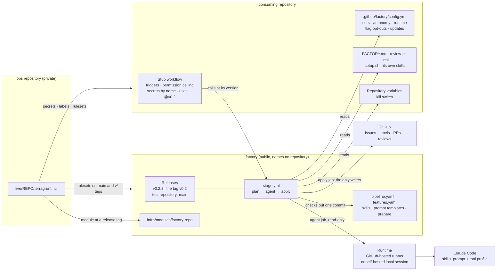
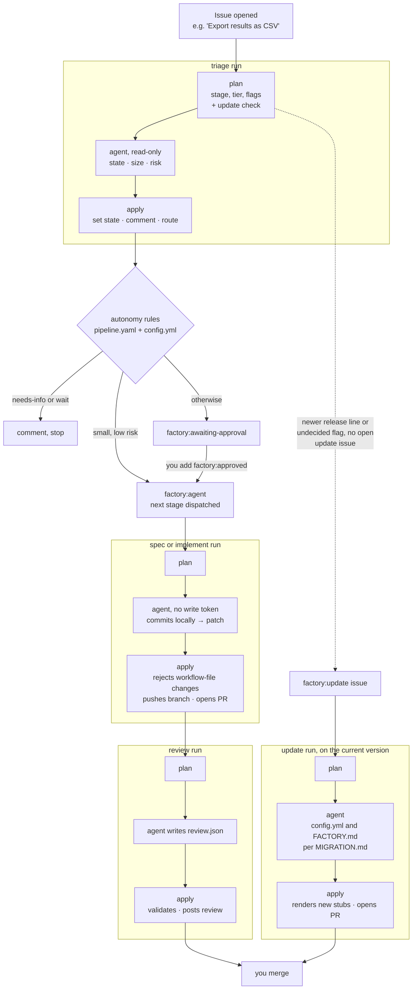

# Architecture at a glance

Status: target architecture for 0.2, as proposed in [rollout.md](rollout.md) and [pipeline.md](pipeline.md). Today (0.1) the factory is still copied into each repository by `scripts/install-factory.sh`.

## Components

Each repository keeps a thin stub and its own settings. Everything else runs from the factory, pinned to the release line the stub calls. The factory names no repository. The ops repository holds the list of repositories and the infra applied to them.

Dependencies point one way. The consuming repository calls the factory, and the ops repository depends on both. The factory depends on neither, and `scripts/check-references.sh` enforces that in CI.

## How an issue flows

An abstract example: someone opens "Export results as CSV" in a consuming repository. Every box marked *run* is the same three-job stage runner. Only apply jobs write to GitHub.

A spec run ends at a specs PR. You merge it and add `ready-to-implement`, which starts the implement run. Flags decide which steps exist for a repository, for example whether medium `ready-to-spec` issues may advance without approval. The update check runs inside whatever run happens next, so an idle repository costs nothing.
