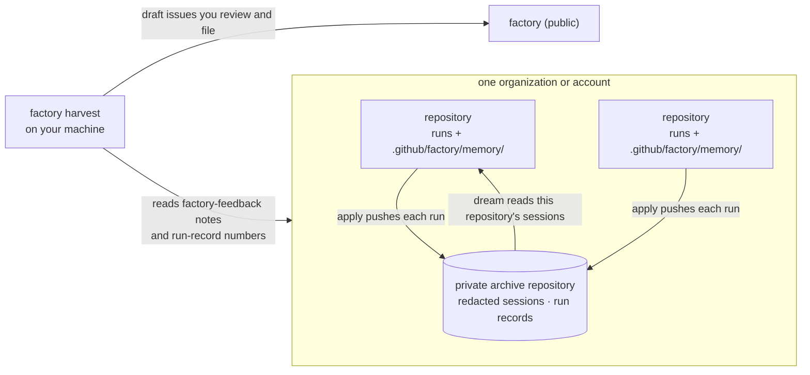

# Session archives and memory

Status: proposal. Nothing here is built. It would ship in parts, each behind a preview flag ([rollout.md §6.1](rollout.md#61-flags)), and be tried in the test repository first. The decisions at the end come before any code.

## The problem

Every factory run starts from nothing. A lesson learned in one run, such as a test that's flaky, a command that burned turns before the right one, or an issue you sent back as sized wrong, is gone when the run ends. The factory keeps no transcripts: `stage.yml` uploads a run's inputs and result with `retention-days: 1` and never saves the agent's session log.

The phase 1 fixes to the factory itself (#21, #22, #23) came from reading the test repository's run logs by hand and turning what went wrong into general fixes. Nothing does that for the factory either, so improvements depend on someone happening to look.

This design is shaped by Anthropic's [components of agent memory](https://www.anthropic.com/research/components-of-agent-memory) and two reference implementations: [dreaming with a dynamic workflow](https://platform.claude.com/cookbook/managed-agents-cma-dreaming-with-a-dynamic-workflow) and the [knowledge wiki](https://github.com/anthropics/claude-quickstarts/tree/main/managed-agents/knowledge-wiki). The ideas it takes from them:

- **Transcripts are the ground truth.** Memory is checked against them, not against what an agent said it did. Phase 1 showed why: agents reported "nothing pushed" above PRs already open.
- **A memory entry is a bet that a later agent can trust it**, so each one carries a date, a source, and whether it was confirmed.
- **Don't store what's cheaply observable.** GitHub already holds issue states, labels and the code. Memory holds what no single document does: why decisions went the way they did, what you corrected, what failed.
- **Keep what every run loads small**, and keep detail one link away.
- **One writer.** Concurrent writers to one page lost facts in the article's tests; the readers mount memory read-only.
- **Transcripts and memory are data, never instructions.**

It doesn't use Managed Agents memory stores. The factory runs on Actions, its cloud runtime is deferred, and memory that sits outside git also sits outside PR review. Memory here is files in the repository, which is rollout requirement 6: repository-specific knowledge stays in the repository.

## Design



There are four parts, each usable without the next:

1. the session archive
2. memory in each repository, read by every stage
3. the dream stage, which writes that memory
4. `factory harvest`, which brings lessons about the factory back to it

### 1. The session archive

Each organization, or personal account, has one private archive repository. Every repository in it that keeps sessions names that archive in its own `config.yml`, so the factory still names no repository:

```yaml
# .github/factory/config.yml
sessions:
  archive: <owner>/<archive>   # a private repository in the same organization or account
```

| Repository | Default | With `sessions.archive` set |
|---|---|---|
| Private | no sessions kept (decision 1) | sessions go to the archive |
| Public | no sessions kept | sessions go to the archive |

One archive per organization fits how the token works. A fine-grained token can reach repositories of one owner only, so `FACTORY_GITHUB_TOKEN`, which already covers that owner's factory repositories, can cover the archive too. An archive in another organization would need another token.

**The audience rule.** An archive must never be readable by more people than any repository that feeds it, because a transcript holds that repository's code, issue text and tool output. Everyone with read on the archive can read every feeding repository's sessions. So give archive access only to people who can read all of those repositories. On a personal account that's usually just you. `factory doctor` checks it: the archive is private, and its collaborators are a subset of each feeding repository's.

**What a run stores.**

```
sessions/<repository>/<yyyy>/<mm>/<run id>-<stage>-<item>.jsonl.gz   # the redacted transcript
runs/<repository>/<yyyy>/<mm>/<run id>-<stage>-<item>.json           # the run record
```

The run record holds the stage, item, factory commit, plan hash, tier and model, flags on, what apply did (state set, PR opened, review verdict), duration and cost. It doesn't hold what happened afterwards, such as your relabel, merge, close or revert. That's in GitHub, so the dream stage reads it there when it runs.

One file per run means concurrent runs never edit the same file, so a push that loses a race just rebases and retries.

**How it gets there.** The agent job uploads claude-code-action's `execution_file` as a short-lived artifact, next to the result. The action's own docs warn that this output can contain secrets. The apply job then:

1. downloads it
2. redacts it: the token values apply knows, common secret patterns, and anything over a size cap per tool result
3. checks through the API that the archive is still private, and refuses to push otherwise
4. pushes both files with `FACTORY_GITHUB_TOKEN`

Pushing with the secret, not the job's own token, means no stub needs `contents: write`. The triage and review stubs don't have it, and raising a stub's ceiling is a breaking change (rollout.md §6). So this part can ship in a 0.2.x patch behind the `session-archive` flag.

A failed archive push is logged in the run summary and doesn't fail the run.

Redaction has to happen before the push, because a secret committed to git is hard to remove. If one gets through, the fix is to rotate the secret, then rewrite or recreate the archive. A separate archive makes that last step possible without touching any working repository.

Local-runtime sessions already leave transcripts on your machine. Archiving them is left for later.

### 2. Memory in each repository

```
.github/factory/memory/
  _index.md            # one line per page: [[slug]], what it covers
  <topic>.md           # one subject per page
  factory-feedback.md  # lessons about the factory itself (part 4)
```

The folder goes under Protected paths in `FACTORY.md`. Only the dream stage writes it, and only through a PR you merge. It's never eligible for auto-merge, if that lands.

Each page has frontmatter (`name`, `description`) and fact lines in one form:

```
- <fact> (<date>, <source link>, confirmed | unconfirmed)
- CONFLICT: <source A, date> says …; <source B, date> says …
- was <old value> until <date>, per <source>
```

A line also says whether it's a decision you made or an agent's observation. An agent's observation never overrides your decision.

What belongs:
- why issues were sent to a human, rejected or resized
- PRs closed without merging, and why
- review findings you dismissed, and ones that turned out right
- triage sizes that turned out wrong, measured by the diff
- flaky tests, slow or broken setup steps, and commands that work
- open questions

What doesn't: anything GitHub or the code already shows, including issue states, labels, file contents and who owns a file.

**Every stage reads it.** Each stage prompt gets a short memory section, behind the `memory` flag: read `_index.md` first, treat each line as a dated claim, and re-check anything the task depends on before relying on it. The article found that strong models only need to be told what memory is for, but older, weaker ones skipped it until told to read it first. The fast tier runs Haiku, which the article didn't measure, so the instruction is explicit.

`FACTORY.md` stays the small file every run loads. The dream stage can suggest promoting a settled lesson into it, but only in its PR description. You make the edit, because `FACTORY.md` holds your decisions.

### 3. The dream stage

A new stage, `dream`, replaces improve-review. Improve-review is already a narrow version: weekly, from how you reacted to reviews, as a PR changing one skill.

| | |
|---|---|
| Triggers | weekly schedule, and dispatch |
| Inputs | this repository's sessions and run records since the last dream, from the archive; what happened to each item since; the current memory folder; `review-pr-local` |
| Agent | balanced tier, read and edit tools on the memory folder only, no shell, no network |
| Output | a patch limited to `.github/factory/memory/` and `.claude/skills/review-pr-local/` (`output.paths`, as improve-review has today) |
| Apply | `open-pr`; the PR description lists suggested `FACTORY.md` changes |
| Concurrency | one group, no cancel: one writer |

The plan job fetches the sessions with `FACTORY_GITHUB_TOKEN` and passes them to the agent job as an artifact, so the agent job still holds no write token.

The agent works in the cookbook's two passes:

1. **Check.** Test each existing memory line against the new transcripts and outcomes, and mark it confirmed, corrected (keeping what it replaced) or in conflict.
2. **Add.** Record new lessons, compare each agent decision with what you did next, and write calibration notes. For example: "issues touching the billing module were sized small three times, and their PRs averaged 400 lines."

Then it tidies: it merges duplicates, fixes links, keeps `_index.md` complete, and keeps each page under a size cap.

A repository has tens of runs a week, so one agent can read them all. That avoids the concurrent-writer problem entirely. The cookbook's parallel analyzers are for hundreds of transcripts.

Calibration notes are how the auto-merge proposal's thresholds could be tuned from evidence. They can only argue for tightening: an agent can veto, never allow.

Repositories without the archive can still dream from what GitHub shows: comments, reviews and outcomes, without transcripts.

### 4. Lessons back to the factory: `factory harvest`

The factory is public and depends on nothing downstream, so it doesn't poll repositories and its CI holds no token for them. Instead, lessons are made abstract inside each repository, then collected from your side:

1. **In each repository**, the dream stage writes lessons it thinks are about the factory into `factory-feedback.md`. Examples: a prompt that misleads agents, a skill gap, a tier that misses things, an apply op that failed. It writes them in general terms, with a link to the evidence in that repository. A lesson counts only once the PR that added it has merged, so you've already read it once.
2. **`factory harvest`** runs on your machine with your `gh` login. It finds repositories by the `factory` topic, as `doctor` and `rotate-secrets` do, and reads:
   - each repository's `factory-feedback.md` from its default branch
   - numbers from the archives' run records: runs, failures and cost per stage, tier and factory version; how often triage's call stood; how often reviews were dismissed

   It never reads transcripts. It merges duplicate lessons across repositories, runs `scripts/check-references.sh` with `FACTORY_PRIVATE_NAMES` over the result, and writes draft factory issues to a local file outside the factory checkout. It posts nothing. You read the drafts and file the ones you want.

Harvest is manual at first. It could later run as a scheduled task on your machine. The factory's CI never runs it.

## How it ships

| Step | What | Flag | Stub change |
|---|---|---|---|
| 1 | Session archive, run records, `doctor` checks | `session-archive` | none |
| 2 | Memory section in every stage prompt | `memory` | none |
| 3 | `dream` stage, replacing improve-review | `dream` | the improve-review stub becomes the dream stub, through `factory update` |
| 4 | `factory harvest` | none (a CLI command) | none |

Step 1 is worth shipping first even if the rest waits: history that wasn't kept can't be backfilled. Steps 2 and 3 go together in practice, since memory is empty until something writes it.

**Cost.** The dreaming cookbook reports about $0.36 for 11 transcripts and about $8 for 50 long ones. Treat those as rough: they came from a partial read of the page, on Managed Agents with the fast tier. A weekly dream over tens of runs on the balanced tier is likely a few dollars per repository per week. The archive costs nothing beyond repository storage.

## Open questions

To answer in the test repository before relying on them:

1. What does `execution_file` contain on v1.0.245: thinking, full tool results, the prompt? How large is a typical run's file?
2. How much does redaction catch on real transcripts? Run it over the test repository's next runs and read the output before anything is pushed.
3. Does `FACTORY_GITHUB_TOKEN` with Contents: write on the archive work alongside its existing scopes without other changes?

## Decisions for the owner

1. **Private repositories by default.** Keep no sessions until `sessions.archive` is set (proposed, matching public repositories), or use a conventional archive name like `<owner>/factory-sessions` when it exists and is private.
2. **Retention.** Keep sessions forever, or prune those older than N days. Pruning still leaves them in git history, so a real purge means recreating the archive.
3. **Thinking blocks.** Keep them in the archived transcript, or drop them to save space and limit what's stored.
4. **Dream replaces improve-review.** Proposed: yes, in step 3.
5. **`FACTORY.md` promotions.** Suggestions in the PR description that you apply (proposed), or edits in the patch.
