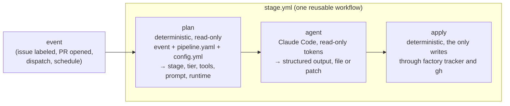

# A configuration-driven pipeline

Status: proposal, a companion to [rollout.md](rollout.md). Nothing here is built yet. Diagrams of the target architecture and an issue's path through it are in [architecture.md](architecture.md).

## The problem

The factory's process is written out in bash and YAML across nine workflow files. Its states, gates, models, tool lists and prompts are each repeated where they're used:

| Concept | Where it lives today | Count |
|---|---|---|
| Workflow states and gates (`ready-to-implement`, `factory:approved`, …) | `if:` conditions, `case` statements, `gh issue edit` calls, skill text | ~100 occurrences in 11 files |
| Model IDs | workflow defaults, infra variables, README | 41 |
| Tool permissions | a hand-written `--allowedTools` string per workflow | 8 workflows, 10 strings |
| Prompts | inline `prompt: \|` blocks; `factory-local.yml` builds its own copy | 8 workflows, already drifting (implement and local disagree on UI verification) |
| Who may advance an issue | a `case` table in triage's apply job, plus `if:` conditions in spec, implement and local | 4 places |
| Where the agent runs | GitHub-hosted (`claude-code-action`) or self-hosted (`claude --bg`), as two unrelated code paths | 2 implementations |

Adding a stage, renaming a state, moving to a new model generation or running a stage somewhere else each means editing several of those places, and keeping them consistent by hand.

## What to abstract, and what not to

Abstract a seam when it already has two implementations or changes often. Keep everything else concrete.

| Seam | Decision | Why |
|---|---|---|
| **The pipeline itself**: states, stages, transitions, gates, autonomy rules | **Configuration** (`pipeline.yaml`) | It's the thing you iterate on. Today one change touches several files. |
| **Model choice** | **Configuration**, as tiers (`fast`, `balanced`, `deep`) mapped to model IDs once | A new model generation becomes a one-line change, and repositories override tiers rather than IDs. |
| **Agent tools** | **Configuration**, as named profiles (`read`, `tracker-read`, `edit`, `shell`, `web`, `browser`) | Ten hand-written strings collapse into a few profiles that can be reviewed in one place. |
| **Prompts** | **Templates**, one per stage (`stages/<stage>/prompt.md`) | Every runtime uses the same prompt, which ends the implement/local drift. |
| **Where the agent runs** (runtime) | **Port with adapters**: `actions` and `local` now; a claude.ai cloud session later | Two implementations already exist. |
| **Work tracker** (GitHub Issues) | **Port with one adapter**: every read and write goes through `factory tracker`, and state names come from configuration | Cheap to do while the workflows are being rewritten anyway, and it puts label handling in one place. Write a second adapter (Linear, say) only when you actually want one. |
| **Code host** (GitHub PRs, reviews, CI) | **Concrete** | Reviews, checks and `pull_request_target` are GitHub through and through. An abstraction here would be speculative and leaky. |
| **Orchestrator** (GitHub Actions) | **Concrete** | Triggers, permissions and secrets are Actions concepts. Leaving Actions would be a rewrite whatever we abstract. |
| **The agent** (Claude Code and its skills) | **Concrete** | Skills, `--json-schema`, `--allowedTools` and sessions are what the factory is built on. The runtime port covers *where* Claude Code runs, not *whether* it is Claude Code. |

## Design

### `pipeline.yaml`: the process as data

The factory ships a default pipeline. It names no repository.

```yaml
# factory/pipeline.yaml
tiers:                         # the only place model IDs appear
  fast:     claude-haiku-5-5
  balanced: claude-sonnet-5-5
  deep:     claude-opus-5-5

tool_profiles:                 # expanded into --allowedTools per runtime
  read:         [Read, Glob, Grep]
  tracker-read: ["Bash(factory tracker get:*)", "Bash(factory tracker related:*)"]
  edit:         [Edit, Write]
  shell:        [Bash]
  web:          [WebSearch, WebFetch]
  browser:      { mcp: verify-behavior/playwright-mcp.json, local: gstack-browse }

states: [ready-to-spec, ready-to-implement, needs-info, wait-to-implement, spec-ready-for-review]
markers: [invariant-risk]      # risk labels the pipeline reads
gate:                          # human approval
  awaiting: factory:awaiting-approval
  approved: factory:approved

autonomy:                      # who advances an issue; replaces triage's case table
  standard:
    - { state: ready-to-implement, size: [small] }
    - { state: ready-to-spec, size: [small, medium] }
  small:
    - { state: [ready-to-implement, ready-to-spec], size: [small] }
  off: []
  never_if: [invariant-risk]

stages:
  triage:
    on: [item.opened, dispatch]
    skill: triage
    agent: { tier: fast, effort: medium, tools: [read, tracker-read], max_turns: 25 }
    output: { structured: schemas/triage.json }
    apply: [set-state, add-markers, comment, route]   # route: autonomy rules → dispatch or gate

  spec:
    on: [state: ready-to-spec, dispatch]
    gated: true
    skill: spec
    agent: { tier: balanced, effort: medium, tools: [read, tracker-read, edit, shell, web], max_turns: 60 }
    risk:  { tier: deep, effort: high }               # when invariant-risk is set
    output: { patch: true, pr: specs }
    apply: [open-pr, set-state: spec-ready-for-review]

  implement:
    on: [state: ready-to-implement, dispatch]
    gated: true
    skill: implementation
    agent: { tier: balanced, effort: medium, tools: [read, tracker-read, edit, shell, web, browser], max_turns: 80 }
    agent_when_autonomous: { tier: fast }
    risk:  { tier: deep, effort: high }
    output: { patch: true, pr: implementation }
    apply: [open-pr]

  review:
    on: [pr.opened, pr.synchronize, pr.ready, dispatch]
    skill: review-pr
    agent: { tier: balanced, effort: medium, tools: [read, "Write(review.json)"], max_turns: 40 }
    agent_when: { changed_lines_at_most: 400, no_markers: [invariant-risk], use: { tier: fast } }
    output: { file: review.json, validate: review-pr/scripts/validate_review_json.py }
    apply: [publish-review]

  update:                                            # rollout.md §6.2–6.3
    on: [item.marker: factory:update]                # opened by the update check in any plan job
    gated: true                                      # config.yml updates.advance: human | agent
    skill: factory-update
    agent: { tier: balanced, effort: medium, tools: [read, tracker-read, edit, shell], max_turns: 40 }
    output: { patch: true, pr: factory-update }
    apply: [render-stubs, open-pr]                   # render-stubs: the target version's `factory update`, never the agent

  # bet-intake, improve-review, dependency-bump follow the same shape
```

Each repository's `.github/factory/config.yml` (from [rollout.md §5](rollout.md#5-each-repositorys-settings-live-in-that-repository)) overrides parameters, never structure:

```yaml
stages:
  implement: { runtime: local }      # run implement as a session on the self-hosted machine
  spec:      { enabled: false }
tiers:
  fast: claude-sonnet-5-5            # this repository never uses Haiku
autonomy: small
```

Flags from rollout.md §6 hook in declaratively. A stage, transition or tool profile can carry `feature: <flag-id>`, and it exists only for repositories where that flag is on. So "a new stage" is a `pipeline.yaml` entry plus a flag, not a new workflow.

### One generic stage runner: plan, agent, apply

Every stage runs as the same three jobs, the shape triage and review already have:



- **plan** decides whether anything should run, and which stage. It resolves the tier, tools, prompt, runtime and flags, and writes them to the job summary. It reads `pipeline.yaml` from the pinned factory commit and `config.yml` from the repository. It also runs the update check ([rollout.md §6.2](rollout.md#62-update-issues-instead-of-a-scheduled-job)). When a newer minor line or a pending flag exists and no update issue is open, plan asks apply to open one. That makes it the only place updates are noticed, and it costs nothing in idle repositories.
- **agent** runs Claude Code through the chosen runtime adapter with read-only tokens. It produces one of three outputs:
  - structured JSON (triage)
  - a validated file (review)
  - a patch plus PR text (spec, implement)
- **apply** is the only job with write permissions. It runs a fixed list of named operations from `pipeline.yaml` (`set-state`, `comment`, `route`, `open-pr`, `publish-review`) and accepts only states and markers that `pipeline.yaml` declares.

Two things follow:

- **Agents lose their write token.** Today implement and spec hand `FACTORY_GITHUB_TOKEN` to the agent, which pushes and opens the PR itself. Under this design the apply job pushes the patch and opens the PR. That is the biggest single reduction of the "one control plane" risk in rollout.md. It also makes `dry_run` honest for every stage: skip apply.
- **One stub per repository becomes possible.** Since every stage goes through `stage.yml`, a repository can have a single `factory.yml` stub that forwards all the events the factory uses. A new stage then needs no stub change. The cost is that the stub's permission ceiling is the union of all stages. Each job still narrows its own permissions, and a compromised factory could do damage anyway, so the union gives up little in practice. Recommended, but decide after phase 1 shows it works.

### The runtime port

```text
run(stage, prompt, tier, effort, tools, output) → result | detached(session_id)
```

| Adapter | Where | Notes |
|---|---|---|
| `actions` | GitHub-hosted runner via `claude-code-action` | Default. Returns its output to the apply job. |
| `local` | self-hosted runner, `claude --bg` | **Detached.** The session outlives the job, so there is no apply job; it opens the PR itself with the machine owner's login, as today. Its guardrails (deny list, setting sources) stay in the adapter. |
| `cloud` (later) | a claude.ai Claude Code cloud session | Also detached. Worth trying when local sessions prove useful but tie up your machine. |

Every adapter gets the same prompt from `stages/<stage>/prompt.md` and the same tools from the profiles. The adapter decides only how to launch: `claude-code-action` inputs, `claude --bg` flags, or a session API call.

### The tracker port

`factory tracker` is a small script, the only code that talks to the work tracker:

```text
get <item>            related <item>         set-state <item> <state>
add-marker <item> <m> gate <item> awaiting|clear
comment <item> <file> create <title> <body-file> [--state s]
```

- **The GitHub adapter** maps states, markers and the gate to labels, using the names in `pipeline.yaml`. Renaming a label becomes one line.
- **Agents read through it too** (`tracker-read`). Prompts and tool lists then stop naming `gh issue view`, and a second tracker wouldn't change any of them.
- **Skills** say "the item's state" and "the approval gate". The plan job puts the actual names in the prompt.

## What this costs

- **Indirection.** Today you can read `factory-triage.yml` top to bottom and see everything. With this design you read `pipeline.yaml`, the runner and an adapter. The plan job's summary, which prints the resolved stage, offsets that per run.
- **A small interpreter to maintain.** The plan job and `factory tracker` are perhaps 400 lines of Python, with unit tests and golden files for each stage's resolved plan. Those plan snapshots double as the flags-off snapshot rollout.md §6 wanted.
- **Patches are harder for long implement runs.** The agent can still commit locally. The apply job pushes the commits as a bundle rather than a single diff, so history is kept.
- **The local runtime is an exception to plan → agent → apply.** It stays detached and writes for itself. That's acceptable because it runs on your machine under your login, but it's a second path to keep in mind.

## When to do it

**Do it in phase 1 of rollout.md, not as a separate later step.** Phase 1 rewrites every workflow into a reusable workflow anyway. Converting them first to nine bespoke reusable workflows, then to one generic runner, would mean rewriting them twice and migrating the test repository twice. Phase 0 (hygiene) is unaffected.

The order within phase 1, each step tried in the test repository before the next:

1. **`pipeline.yaml`, tiers, tool profiles, prompt templates, `factory tracker`, and `stage.yml` for triage and review.** They already have the three-job shape, so this step only proves the runner and the config.
2. **Implement and spec on patch output plus apply.** Agents lose `FACTORY_GITHUB_TOKEN`.
3. **The `local` runtime adapter.** `factory-local.yml` is deleted, and `stages.implement.runtime: local` replaces the `factory:local` label. Keep the label as a per-item override, which the plan job reads.
4. **bet-intake, improve-review and dependency-bump.**
5. **Optionally, collapse to a single stub.**

Not planned until there is a need: a second tracker adapter, the `cloud` runtime, and structural pipeline changes from repositories (custom stages). Repositories can already add their own skills. Letting them add stages to `pipeline.yaml` is the natural next step if one asks for it.
