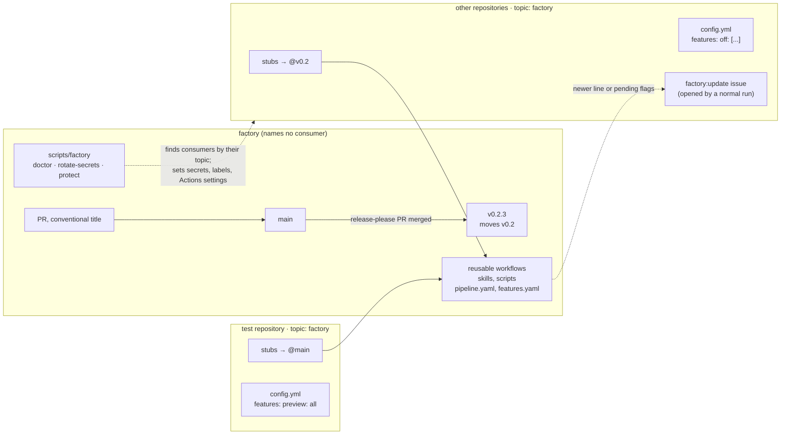

# Rolling out factory changes

Status: proposal, third draft. Phase 0 is in progress. Diagrams of the target architecture and an issue's path through it are in [architecture.md](architecture.md). The factory can stay private or go public (§11), versions stay below 1.0 so this architecture ships as a minor release, and repositories learn about updates through issues the factory opens during runs that happen anyway, not from a scheduled job. The companion [pipeline.md](pipeline.md) makes the stages themselves configuration.

## The problem

A factory change reaches a repository only when someone reruns `install-factory.sh` in a clone of it, commits the result and merges it. Of the factory's first 11 commits, 9 changed workflow templates, 2 changed skills and 4 changed infra variables. Every one meant a reinstall and a PR in each repository. Each copy stays pinned to whatever factory commit it was last installed from, and nothing notices when it falls behind. A change reaches every repository at once or none of them.

## Requirements

1. **One merge, then a release, reaches every repository.** Ordinary changes need no PR in each repository.
2. **A test repository goes first.** One repository runs changes before the rest get them.
3. **The factory names no other repository.** Dependencies point one way: repositories depend on the factory, never the reverse. The factory holds no registry, no per-repository settings, no per-repository infra, and no repository names in its docs. CI enforces this (`scripts/check-references.sh`).
4. **Repositories track the latest release by default, with new behavior behind flags.** Anything that does something new arrives behind a named flag. It's announced before it turns on, and a repository can turn it off.
5. **Nothing runs on a schedule just to check for updates.** Checking for updates costs nothing when a repository is idle and stays sustainable as the number of repositories grows.
6. **Repository-specific knowledge stays in the repository.** That means `FACTORY.md`, the repository's settings, `review-pr-local`, `setup.sh` and its own skills.

## The pattern's downsides, and what this design does about them

| Downside | Severity | Mitigation |
|---|---|---|
| **One control plane.** Whatever a release tag points to runs with every repository's secrets, including `FACTORY_GITHUB_TOKEN`, which can write to all of them, and on your machine for `factory-local`. Today a bad factory commit stays put until someone reinstalls; with this design it reaches every repository on the next run. | Critical | Rulesets on the factory's `main` and `v*` tags. No agent token covers the factory. Secrets are passed by name. The local deny list blocks tag pushes. Agents lose their write token entirely ([pipeline.md](pipeline.md)). |
| **Behavior changes with no PR in the repository.** | High | Change classes, flags and update issues (§6). Each run's summary shows the factory commit and the flags that are on. |
| **Jobs in one run could see different factory versions.** | High | The run resolves the called workflow's commit once and uses it in every job (§3). |
| **Interactive sessions lose the skills.** | Medium | A SessionStart hook copies the pinned skills in (§4). |
| **The permission ceiling lives in the stub.** A new permission, trigger or input means a stub change in every repository. | Medium | Classified as breaking: it ships as the next minor line, and each repository adopts it through an update issue (§6). |
| **Hard to debug.** | Medium | The run summary shows the resolved plan. The factory's CI lints the reusable workflows. |
| **The test repository doesn't exercise every path**, for example library releases and dependency bumps. | Medium | Run `factory try` in a library repository for changes to those paths (§7). |
| **Rollback doesn't undo side effects.** | Low | Accepted. Writes stay in separate jobs that are easy to audit. |
| **A bad change, such as a dispatch loop, hits every repository's bill at once.** | Low | `--max-turns`, timeouts and concurrency groups already limit it, and the test repository goes first. |
| **GitHub behavior not yet verified.** See Open questions. | ? | Prove each in phase 1, in the test repository. |

## Design



### 1. Reusable workflows called by small stubs

Workflow logic moves into this repository's `.github/workflows/` as reusable workflows (`on: workflow_call`). [pipeline.md](pipeline.md) reduces those to one generic stage runner. Each consuming repository keeps a generated stub per stage, or one stub for all of them. A stub holds only what has to live in that repository: the triggers, concurrency, the permission ceiling, the secrets it passes, and the version it calls.

```yaml
# .github/workflows/factory-review.yml: generated by `factory install`; edit .github/factory/config.yml instead
name: "Factory: review"
on:
  pull_request_target:
    types: [opened, synchronize, reopened, ready_for_review]
  workflow_dispatch:
    inputs:
      pr_number: { description: Pull request number to review, required: true, type: number }
      dry_run: { description: Don't post the review, type: boolean, default: false }
concurrency:
  group: factory-review-${{ inputs.pr_number || github.event.pull_request.number }}
  cancel-in-progress: true
jobs:
  review:
    uses: <owner>/factory/.github/workflows/review.yml@v0.2
    with:
      pr_number: ${{ inputs.pr_number || github.event.pull_request.number }}
      dry_run: ${{ inputs.dry_run || false }}
    permissions:
      contents: read
      pull-requests: write
      issues: write            # update issues (§6)
      id-token: write          # only to read the called workflow's own commit (§3)
    secrets:
      CLAUDE_CODE_OAUTH_TOKEN: ${{ secrets.CLAUDE_CODE_OAUTH_TOKEN }}
      ANTHROPIC_API_KEY: ${{ secrets.ANTHROPIC_API_KEY }}
```

- **Secrets are passed by name**, never with `secrets: inherit`.
- **One level of nesting.** A stub calls one reusable workflow, which calls none.
- **A library's release-please workflow calls `notify-consumers.yml` directly.** The consumer list stays in that library's `FACTORY.md`.

### 2. Versions: below 1.0, with the minor number as the breaking-change number

The factory uses release-please and conventional PR titles. Until 1.0:

| PR title | Release | Example | Reaches a repository tracking `@v0.2` |
|---|---|---|---|
| `fix:`, `chore:`, `docs:` | patch | 0.2.3 → 0.2.4 | on release |
| `feat:` (behind a flag, §6) | patch | 0.2.4 → 0.2.5 | on release, with the flag in its declared state |
| `feat!:` | **minor** | 0.2.5 → 0.3.0 | only when the repository moves to `@v0.3`, through an update issue |

release-please is configured with `bump-minor-pre-major` and `bump-patch-for-minor-pre-major`. Each release moves a tag for its minor line (`v0.2`), and that tag is what "latest by default" means. Version 0.1.0 is the current installer-based factory, cut at the end of phase 0. This architecture is `feat!` and ships as **0.2.0**. Moving to 1.0 is a separate decision for when the contract has settled. After that, the same scheme carries on with `v1` and major versions.

Each repository picks its ref. Nothing in the factory records the choice:

| Ref in the stub | Gets | Use for |
|---|---|---|
| `@main` | every merge | the test repository |
| `@v0.2` (default) | every release in the 0.2 line | everyone else |
| `@v0.2.3` | that release only | freezing a repository; Dependabot can bump it |

Merging the release-please PR is the promotion. Until then, merged work runs only in repositories that track `main`, which gives the test repository a soak period for free. Rollback is a revert PR plus a release. In an emergency, dispatch the release workflow with `rollback: v0.2.3`, and it moves `v0.2` back to that release. Nobody moves tags by hand: the tag ruleset lets only the release workflow do it.

### 3. One commit per run, and a run that says what it ran

- **One commit for the whole run.** The first job finds the commit of the workflow it was called at, `job_workflow_sha`, from the OIDC token or a workflow context (unverified). Every later job checks out the factory at that commit, and the stub doesn't repeat the ref.
- **The setup action matches the workflow.** Each job starts with `uses: ./.factory/.github/actions/prepare`, a local path in that checkout, so the action is always the same version as the workflow.
- **What ran is visible.** `prepare` writes the job summary: the commit and release, the resolved config and where each value came from, the flags that are on, and any pending update.
- **Fetching the factory.** If the factory is public, checkout and tarball downloads are anonymous. If it is private, each consuming repository holds `FACTORY_READ_TOKEN`, read-only on the factory alone, used only by the checkout step and never given to the agent (§11).

### 4. Skills and scripts come from the pinned commit

- **CI.** `prepare` copies `.factory/skills/<name>` into `.claude/skills/<name>`, so existing paths keep working. The consuming repository gitignores the factory-managed skill directories and `.factory/`.
- **Overrides.** A factory skill the repository has committed (`git ls-files .claude/skills/<name>`) is the repository's own fork. `prepare` leaves it alone and says so. Repository-owned skills, such as `review-pr-local`, aren't touched.
- **Interactive sessions and `factory-local`.** A SessionStart hook in the repository's `.claude/settings.json`, added by `factory install`, reads the ref from a stub and copies that version's skills in. It downloads them anonymously from a public factory, or with your `gh` login from a private one (a claude.ai cloud session then needs the factory attached), and skips the download if the skills are already current.
- **The improve-review loop writes only `review-pr-local`**, starting in phase 0.

### 5. Each repository's settings live in that repository

Each repository has a committed `.github/factory/config.yml`:

```yaml
autonomy: small
effort: { triage: high }
features:
  off: [spec-auto-advance]
updates:
  check: true          # default; false = never open update issues
  advance: human       # default; agent = an agent may implement update issues
```

- **Precedence**, highest first:
  1. A repository Actions variable. It is the kill switch, and agents can't change it.
  2. `config.yml`.
  3. The factory's defaults.
- **Where it's read from.** For `pull_request_target`, `config.yml` is read from the default branch, so a PR can't change the config its own review uses.
- **Protection.** List `config.yml` under Protected paths in `FACTORY.md`.

### 6. New behavior: classes, flags, and update issues

**The PR title declares the class** (§2):

- **`fix`** brings behavior back to what is documented. It adds no new GitHub writes, tools, permissions, triggers, labels or outputs, and changes no defaults.
- **`feat`** is any new effect a repository could notice: a new write action, tool or MCP server, a new instruction to the agent, more model calls or cost, a changed default, a new stage. It ships behind a flag.
- **`feat!`** changes what a repository provides or relies on: `workflow_call` inputs, secrets or permission ceiling, triggers, job IDs, artifact names, paths the repository owns, labels, the `config.yml` schema, or locking a flag. It needs an entry in `MIGRATION.md` that an agent can follow (§6.4).

Commit af9f982 shows why. It was titled `fix(local)`, but it changed the default setting sources for local sessions, which silently took user-level skills away from repositories that hadn't set the variable. Under these rules it is a `feat`.

#### 6.1 Flags

`features.yaml` declares every flag. It names no repository:

```yaml
spec-auto-advance:
  summary: Agents may start the spec stage for medium ready-to-spec issues without approval.
  stages: [triage]
  state: default            # preview | default | locked
  added: 0.2.5
  default_from: 0.2.6       # on for everyone not opted out, from this release
  retire_after: 0.3.0
  cost: none
```

**Lifecycle.**
1. **preview**: off unless a repository opts in. The test repository uses `preview: all`.
2. **default**: announced one release ahead, then on from `default_from` unless the repository opted out. A flag only turns on with a release, never on a date.
3. **locked**: the opt-out is removed. That is a `feat!`, so it waits for the next minor line.
4. **retired**: the flag and the old code path are deleted.

**Gating.** `prepare` resolves the flags (defaults, then `config.yml`, then a variable override) into JSON:
- Workflow steps check that JSON with `if:`.
- New skill behavior lives in `skills/<skill>/features/<flag>.md`, and the prompt names it only when the flag is on.

#### 6.2 Update issues instead of a scheduled job

Repositories don't run a weekly job. The update check is part of the plan step, which runs at the start of every factory run in that repository, whether triage, review or anything else. The check:

1. Reads the factory's latest releases. That is one call to the factory's tags: anonymous when it is public, with `FACTORY_READ_TOKEN` when it is private.
2. Compares them with what this run resolved (§3) and with `config.yml`. Two things are worth an issue:
   - **A newer minor line** (`v0.3` exists and the stub calls `@v0.2`). That is a breaking release to adopt.
   - **Flags that will turn on in the next release, or are new in preview**, and that the repository hasn't decided on (they're in neither `features.on` nor `features.off`).
3. If either is true and no open issue labeled `factory:update` exists, it opens one. Otherwise it updates the open one's checklist. There is never more than one.

The check costs nothing when a repository is idle, because nothing runs. The next issue or PR catches it up. It scales with activity, not with the number of repositories. `updates.check: false` in `config.yml` turns it off.

An update issue lists:
- the current and available versions, with links to the release notes
- each `MIGRATION.md` step between them
- for each pending flag: its summary, cost, the release it turns on in, and the one-line opt-out

#### 6.3 The update issue goes through the factory like any other issue

An update issue is a normal work item:
- It is created `ready-to-implement` with the `maintenance` and `factory:update` labels.
- The plan step sends `factory:update` items to the **update stage** instead of implement.
- That stage runs on the factory version the repository is on now. The current factory implements the move to the next one.

**Who advances it.** `updates.advance` decides:
- `human` (the default) adds `factory:awaiting-approval`. You approve, or first comment which flags to switch off.
- `agent` lets triage's usual autonomy rules apply. An update with only patch-level flag decisions can then proceed on its own.

**What the update stage does.**
1. **Agent part.** It reads the target release's `MIGRATION.md` entries, your comments, and the pending flags. It edits `config.yml` (opt-outs, renamed keys), `FACTORY.md` and anything else the migration notes describe. Then it opens one PR that closes the issue.
2. **Deterministic part.** If the update moves to a new minor line, the apply job renders the new stubs with the target version's own `factory update --to v0.3`. The agent never writes workflow files.

**Workflow files need a token with Workflows: write.**
- Once agents no longer hold a write token ([pipeline.md](pipeline.md) phase 1, step 2), the apply job's token can have that permission. Its `open-pr` operation rejects any agent patch that touches `.github/workflows/`. Only the update stage's rendered stubs may.
- Until then, the update PR carries everything except the stubs. Its body says to run `factory update` locally to finish, or the `local` runtime does it with your login.

#### 6.4 The factory's CI keeps the classes honest

1. **Title lint.** The PR title must follow conventional commits. This is done in phase 0.
2. **`contract.lock`** is generated from the reusable workflows and `pipeline.yaml`. It records their inputs, secrets, outputs, job IDs, permissions, tool profiles, triggers, defaults and labels.
   - A diff that does more than add an optional input needs `!`.
   - A change to tools, permissions, write steps or defaults fails under `fix:`.
3. **`MIGRATION.md`.** A `!` title must change `MIGRATION.md`.
4. **The `features.yaml` lint.** Every flag used is declared, every declared flag is used, and a flag past `retire_after` fails the build.
5. **`review-pr` on factory PRs** checks whether the class is right. It is advisory.

### 7. Trying a branch before it merges

Run `factory try` from inside a consuming repository, with your own `gh` login:

```bash
factory try review 42 --ref my-branch
```

1. It pushes a throwaway branch, `factory-try/my-branch`, whose stubs call `@my-branch`.
2. It runs `gh workflow run … --ref factory-try/my-branch -f dry_run=true`.
3. It prints the run URL. `--cleanup` deletes the branch afterwards.

Under `dry_run`, every stage skips its apply job. Implement and spec upload their patch as an artifact instead of opening a PR. `try` runs a factory branch with that repository's secrets, so only run branches you wrote.

### 8. Consumers declare themselves; no infra

- **The mechanic.** Each repository declares on its own side that it consumes the factory, and the factory's CLI discovers consumers by that declaration. The factory never lists them, and there is no separate ops repository or infra state.
- **The implementation on GitHub.** The declaration is a repository topic, `factory` (`FACTORY_TOPIC` overrides it). `gh repo list <owner> --topic factory` finds every consumer your login can see. A host other than GitHub would keep the mechanic and change only this detail.
- **`factory doctor [--fix]`**, run inside a repository, checks and repairs its declaration, labels and Actions settings, reports its secrets, and with `--protect-default-branch` its default-branch ruleset. It reports drift one repository at a time; there is no fleet-wide plan.
- **`factory rotate-secrets`** sets each exported secret on every declared repository and prints the list. A consumer missing from it lacks the declaration. Secret values are piped to `gh` and never stored, which removes the plaintext secrets that Terraform state held.
- **Model, effort and autonomy settings** stay optional repository variables until 0.2, then move into each repository's `config.yml`.
- **Labels** come from one file, `templates/labels.txt`, read by `doctor` and the installer. Workflows already create missing labels when they need them.

### 9. Protecting the factory

The factory is the most powerful repository you own, so:

- **Rulesets**, set with `scripts/factory protect`, run inside the factory:
  - On `main`: changes only through a PR, no force pushes, no deletion.
  - Rulesets are free on a public repository; a private one needs GitHub Pro or higher (§11).
  - On `refs/tags/v*`: only GitHub Actions (the release workflow) may create, move or delete tags. There is no bypass for admins, because local sessions run with your login, which is an admin. Roll back through the workflow's `rollback` input.
- **No agent token covers the factory.**
- **Pull requests from forks** run only the factory's own CI, which uses no secrets and never `pull_request_target`.
- **The `factory-local` deny list** blocks tag pushes. The self-hosted runner should run as a dedicated macOS user. Until it does, keep local sessions in repositories pinned to a release.

### 10. One command-line tool, scoped to the repository it runs in

| Command | Does |
|---|---|
| `factory install` | first setup: stubs at the current minor line, `.gitignore` block, SessionStart hook, `config.yml`, `FACTORY.md`, `vision.md`, `bets.md` |
| `factory update [--to v0.3]` | renders stubs for a version and applies its `MIGRATION.md` steps that a script can do; the update stage's apply job runs the same thing |
| `factory try …` | §7 |
| `factory doctor [--fix]` | checks and repairs the consumer declaration, labels and Actions settings, and reports secrets; in 0.2 also the config schema and whether the stubs match the version they call. Exists today |
| `factory rotate-secrets` | sets exported secrets on every declared consumer. Exists today |
| `factory protect` | run inside the factory: rulesets on `main` and `v*` tags. Exists today |
| `factory materialize` | what the SessionStart hook runs |

### 11. Public or private

The design works either way. The factory names no other repository, so going public exposes no repository names in the current code; its history is another matter (decision 1 in the pilot notes).

| | Public | Private |
|---|---|---|
| Fetching the factory in CI | anonymous | `FACTORY_READ_TOKEN` in each repository, set and renewed by `factory rotate-secrets`; when it expires, every repository's runs stop until it is renewed |
| Calling its reusable workflows | works | needs Settings → Actions → General → Access set to the owner's repositories (`factory protect` sets it); whether a personal account offers this was open question 5 |
| Rulesets on `main` and `v*` tags | free | need GitHub Pro or higher; without them only the local deny list stops a tag being moved |
| Interactive sessions fetching skills | anonymous | your `gh` login; claude.ai cloud sessions need the factory attached |
| Dependabot bumps of pinned versions | works | unverified |
| Who sees prompts and workflows, who can open PRs | anyone; forks run only the factory's CI | only you |

Two checks settle it. Private reusable-workflow sharing works on a personal account (open question 5, tested). That leaves GitHub Pro (open question 6): with it, private costs one more token; without it, public is simpler, or upgrading also lets other private repositories protect `main`.

## Credentials

| Secret | Where | Scope |
|---|---|---|
| `FACTORY_GITHUB_TOKEN` | each repository | unchanged; never includes the factory. Gains Workflows: write only once agents no longer hold it (§6.3) |
| `CLAUDE_CODE_OAUTH_TOKEN` or `ANTHROPIC_API_KEY` | each repository | unchanged |
| `FACTORY_READ_TOKEN` | each repository, **only while the factory is private** | fine-grained, the factory only, Contents: read. Set and renewed by `factory rotate-secrets` |
| `FACTORY_PRIVATE_NAMES` (optional) | the factory | names `check-references.sh` must never find, kept out of the code (it matters most if the factory goes public) |

## Migration

**Phase 0: hygiene, ending in v0.1.0.** On the branch now:
1. Remove every reference to another repository, and replace the Terraform infra with self-declared consumers and `scripts/factory` (`doctor`, `rotate-secrets`, `protect`). Add `scripts/check-references.sh` to CI. Make the installer's extra skills generic (`--with-skills`).
2. Point improve-review-pr at `review-pr-local` only.
3. Block tag pushes in `factory-local`. `factory protect` sets the factory's rulesets.
4. Add the PR-title lint and release-please (pre-1.0 settings, moving `v0.N` tags).
5. Merge, choose public or private (§11), run `factory protect`, tag each consumer (`factory doctor --fix`), run `factory rotate-secrets`, delete the old Terragrunt state, and cut v0.1.0.

**Phase 1: the test repository on `@main`; ships as v0.2.0.**
1. Build the reusable workflows as the generic stage runner from [pipeline.md](pipeline.md), along with:
   - `prepare`
   - `pipeline.yaml`, `features.yaml` and `contract.lock`
   - the `config.yml` schema
   - the update check and the update stage
   - the `factory` CLI
2. Run `factory install` in the test repository. It replaces the vendored copies with stubs at `@main`, adds `config.yml` with `preview: all`, and adds the hook.
3. Answer the open questions.
4. Exit when:
   - every stage, an interactive session and the update stage have all run green from `@main`
   - a test flag has gone from preview to default and produced an update issue

**Phase 2: everyone else on `@v0.2`.**
1. Run `factory install` once in each repository. That is one PR each, and the last manual install.
2. After that, every adoption is an update issue.
3. Move each repository's settings from its repository variables into its `config.yml`.
4. Delete `templates/github/workflows/` and the installer's copy mode.

## Open questions

Tested on 2026-11-02 with a throwaway reusable workflow in the private factory, called from a private consuming repository on the same personal account:

| Question | Result |
|---|---|
| 1. Do `vars` in a called workflow resolve to the caller's repository variables? | **Yes.** The called workflow read the caller's `FACTORY_VERIFY` and `FACTORY_LOCAL_SETTING_SOURCES`. |
| 2. Can a run find the commit of the workflow it was called at? | **Yes, from the OIDC token** (`job_workflow_sha`, with `id-token: write` in the stub). `github.workflow_sha` is the caller's commit, not the factory's. |
| 3. Check names | **`<stub job> / <called job name>`**, for example `call / Probe`. Any required check has to be renamed once. |
| 5. Can a personal account's private repositories call a private factory's reusable workflows? | **Yes, once the factory's Settings → Actions → General → Access allows repositories owned by the user** (`factory protect` sets it). Before that, the call fails at startup. |
| Can the caller's `GITHUB_TOKEN` check out a private factory? | **No** ("Repository not found"), so a private factory needs `FACTORY_READ_TOKEN`. |

Still open:

4. **Tag-ruleset bypass on a personal account.** Does the bypass for the GitHub Actions app work on a repository owned by a personal account? If not, the release workflow moves tags with a token that has Contents: write on the factory only, kept in the factory's secrets.
6. **GitHub Pro.** Rulesets on a private factory need it. The pilot notes record the account as GitHub Free and plinth's `main` as unprotected for that reason. Either upgrade (which also lets plinth protect `main`) or make the factory public.
