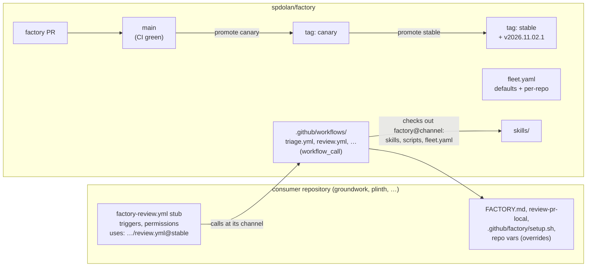

# Rolling out factory changes

Status: proposal. Nothing here is built yet.

## The problem

Every factory change reaches a repository only when someone runs `install-factory.sh` in a clone of it, commits the result and merges it. With four repositories that is four reinstalls and four PRs per change. Configuration changes (models, effort, autonomy) need a separate `terragrunt apply` from a laptop that has the secrets.

The history shows where the churn is. Of the 11 commits since the first release:

| What changed | Commits | How it reaches a repository today |
|---|---|---|
| Workflow templates | 9 | reinstall, commit and merge, in every repository |
| Skills | 2 | reinstall, commit and merge, in every repository |
| Infra variables and settings | 4 | `terragrunt run --all apply` from a laptop |

PR #11 says so itself: "Installed repositories keep the old names until the installer is rerun."

Two more costs come with that:

- **Copies drift.** Each repository holds its own copy of about 2,600 lines of skills and workflows, pinned to whichever factory commit it was last installed from. `.claude/factory.lock` records it, but nothing checks it.
- **No staged rollout.** A change goes to every repository at once or to none, and rolling it back means reinstalling the old version everywhere.

## Goals

1. **One merge rolls out a change.** Merging a factory PR and promoting it updates every repository, with no PR in each one.
2. **Canary first.** A change runs in one repository before the rest get it, and one command rolls it back.
3. **Try before merging.** A factory branch can run against a real issue in a real repository without changing that repository's default branch.
4. **Configuration is code in this repository.** Models, effort and autonomy are edited by PR to the factory and go out with the same promotion as code.
5. **Repository-specific knowledge stays in the repository.** That covers `FACTORY.md`, `review-pr-local`, `setup.sh` and the repository's own skills. The improve-review loop keeps working.

## Design



### 1. Reusable workflows with thin stubs in each repository

Workflow logic moves from `templates/github/workflows/` into `.github/workflows/` of this repository as reusable workflows (`on: workflow_call`). Each consuming repository keeps one stub per stage. A stub holds only what has to live in the consuming repository:

- the triggers (`issues`, `pull_request_target`, `workflow_dispatch`, `repository_dispatch`)
- concurrency
- the maximum permissions (a called job can narrow permissions but never widen them)
- `secrets: inherit`
- the channel it calls

```yaml
# .github/workflows/factory-review.yml in groundwork: generated, do not edit
name: "Factory: review"
on:
  pull_request_target:
    types: [opened, synchronize, reopened, ready_for_review]
  workflow_dispatch:
    inputs:
      pr_number: { description: Pull request number to review, required: true, type: number }
concurrency:
  group: factory-review-${{ inputs.pr_number || github.event.pull_request.number }}
  cancel-in-progress: true
jobs:
  review:
    uses: spdolan/factory/.github/workflows/review.yml@canary
    with:
      factory_ref: canary
      pr_number: ${{ inputs.pr_number || github.event.pull_request.number }}
    permissions:
      contents: read
      pull-requests: write
    secrets: inherit
```

Stubs change only when a trigger or permission changes, which has not happened since the first release. Everything else, including job structure, steps, prompts, `--allowedTools`, the `claude-code-action` version and the security split in review, lives in the factory and moves with the channel. The `claude-code-action` version is pinned in nine files today. Dependabot on this repository can bump it in one place and send it through canary.

`factory-notify-consumers.yml` is already `workflow_call`. A library's release-please workflow calls `spdolan/factory/.github/workflows/notify-consumers.yml@stable` directly, so the library doesn't need a copy.

### 2. Skills and scripts come from the pinned factory, not from copies

Every reusable workflow starts the same way:

```yaml
- uses: actions/checkout@v4                 # the consumer, as today
- uses: actions/checkout@v4                 # the factory, at the caller's channel
  with:
    repository: spdolan/factory
    ref: ${{ inputs.factory_ref }}
    path: .factory
    token: ${{ secrets.FACTORY_READ_TOKEN }}
    persist-credentials: false
- uses: ./.factory/.github/actions/prepare  # a local path, so it is the same ref
```

`prepare` does three things:

1. **Materializes skills.** It copies `.factory/skills/<name>` to `.claude/skills/<name>`. The paths the prompts and deterministic steps already use stay valid, for example `.claude/skills/review-pr/scripts/publish_review.py`.
2. **Resolves configuration** (section 3) and exports it as step outputs.
3. **Keeps the agent from committing factory files.** Consuming repositories list the factory-managed skill directories and `.factory/` in `.gitignore`, so the implement and spec agents can't commit them with `git add -A`.

**Overrides.** Repository-owned skills (`review-pr-local`, `onboard-city`) are committed as they are today, and `prepare` never touches them. To fork a factory skill for one repository, set `skills.<name>: local` in `fleet.yaml` and commit the repository's own copy. `prepare` then leaves that one alone and logs that it did. A deliberate fork is the only reason a repository would hold a factory skill, so no copy goes stale unnoticed.

**The improve-review loop** already prefers `review-pr-local` for repository-specific lessons. Its prompt changes so that it writes only `review-pr-local` and never the core `review-pr`, which no longer lives in the repository. When a lesson looks portable, it says so in its PR, and a human ports it to the factory. A later step could open that factory PR automatically.

`factory-local.yml` (self-hosted sessions) materializes the same way. The job already prepares the persistent clone. It also fetches the factory at the stub's channel and copies skills into the session's worktree before `claude --bg` starts.

### 3. Configuration lives in `fleet.yaml`, read at run time

```yaml
# fleet.yaml
defaults:
  channel: stable
  autonomy: standard
  review_small_lines: 400
  models:
    triage: claude-haiku-5-5
    implement_agent: claude-haiku-5-5
    implement: claude-sonnet-5-5
    review_small: claude-haiku-5-5
    review: claude-sonnet-5-5
    spec: claude-sonnet-5-5
    risk: claude-opus-5-5
    bump: claude-haiku-5-5
  effort: { triage: medium, implement: medium, review: medium }

repos:
  groundwork:
    channel: canary
    verify: true
    local: { setting_sources: "user,project,local" }
  plinth:
    autonomy: small
    effort: { triage: high }
    stages: [triage, spec, implement, review, improve-review, local, notify-consumers]
  judicial_outcomes:
    autonomy: small
    effort: { triage: high }
  novelty_audit: {}
```

Precedence, highest first:

1. A repository Actions variable (`FACTORY_AUTONOMY=off`). It is the per-repository kill switch, and it takes effect on the next run without a promotion.
2. `repos.<name>` in `fleet.yaml`.
3. `defaults` in `fleet.yaml`.

The workflow reads `fleet.yaml` from the factory checkout at the caller's channel, so a configuration change goes through canary and stable like code. Changing a model tier becomes a factory PR plus a promotion, with no `terragrunt apply`.

`fleet.yaml` is also the registry. It names the repositories, each one's channel and which stages it gets. Terragrunt reads it with `yamldecode` instead of keeping its own list in `infra/live/*/terragrunt.hcl`. Terragrunt then manages only what is rare and needs admin rights: secrets, labels, Actions permissions, the private-repository access setting, and the default-branch ruleset.

The label list is written out three times today, in the installer, in `root.hcl` and as colors in `factory-triage.yml`. It moves to `labels.yaml`, read by all three.

### 4. Channels, promotion and rollback

| Ref | What it is | Who uses it |
|---|---|---|
| `main` | every merged PR, after CI | nobody in production; `try` runs (section 5) |
| `canary` | a moving tag | groundwork, which gets the most traffic and has a viewer, so failures show quickly |
| `stable` | a moving tag | plinth, judicial_outcomes, novelty_audit |
| `v2026.11.02.1` | an immutable tag for each stable promotion | rollback; a repository that must freeze |

A new `factory-promote.yml` (dispatch: `channel`, `sha`) refuses a commit whose CI isn't green. It moves the tag, and for `stable` it creates the immutable tag and a GitHub release whose notes are the commits since the last stable. Rollback is `promote stable --sha v2026.11.01.1`, and every repository picks it up on its next run.

The release cadence follows from this. Merge to main whenever you like, promote to canary when you want it exercised, and promote to stable after a day or two of canary runs look right. Use `factory status` (section 6) to check them.

### 5. Trying a factory branch on a real repository

`issues` and `pull_request_target` events always run the stub on the default branch, but `workflow_dispatch` runs the stub from whatever branch you name. So:

```bash
scripts/factory try groundwork review 42 --ref my-branch
```

This uses your own `gh` login, which can write workflow files. It:

1. pushes a throwaway branch `factory-try/my-branch` to groundwork, whose stubs call `@my-branch`
2. runs `gh workflow run factory-review.yml --ref factory-try/my-branch -f pr_number=42 -f dry_run=true`
3. prints the run URL

With `dry_run: true`, every reusable workflow skips its write job (triage's apply, review's publish, the implement and spec push and PR) and prints what it would have done, so a try costs model tokens and nothing else. `--live` turns that off, and `--cleanup` deletes the branch.

This is the fast iteration loop for the factory itself. Edit, push a branch, run `try` against a known issue or PR, read the run, then merge.

### 6. One CLI for the fleet

`scripts/install-factory.sh` becomes `scripts/factory`:

| Command | Does |
|---|---|
| `factory install` | first-time setup in a repository: stubs, `.gitignore` block, `FACTORY.md`, `vision.md`, `bets.md` |
| `factory sync [repo…]` | renders stubs from `fleet.yaml` and opens or updates one `factory/sync` PR per repository whose stubs differ |
| `factory try …` | section 5 |
| `factory promote <channel> [sha]` | dispatches `factory-promote.yml` |
| `factory status` | for each repository: channel, the commit it resolves to, stub drift, last run of each stage |
| `factory materialize` | copies skills into `.claude/skills/` locally, for interactive `/triage 12` until the plugin (section 7) exists |

A `factory-sync.yml` workflow in this repository runs `factory sync` when `templates/stubs/` or a channel in `fleet.yaml` changes on main. It is the only automation with workflow-write access to consuming repositories. Its token (`FACTORY_SYNC_TOKEN`) lives only in this repository's secrets, and no agent ever runs in that job. Because stubs rarely change, sync PRs are rare. Most changes need none.

### 7. Interactive and cloud sessions

CI and `factory-local` get skills from the pinned checkout. For people working in a repository (claude.ai sessions, a laptop), the factory also publishes its skills as a Claude Code plugin from a marketplace in this repository (`.claude-plugin/marketplace.json`). Each consuming repository enables it in a committed `.claude/settings.json`. Skills then appear as `/factory:triage` and stay current without a sync. `claude-code-action` has `plugins` and `plugin_marketplaces` inputs, so CI could later use the plugin too. The pinned checkout stays the primary path in CI, because the deterministic steps need the scripts at known paths.

## Credentials

| Secret | Where | Scope | Why |
|---|---|---|---|
| `FACTORY_GITHUB_TOKEN` | every consuming repository | unchanged | agents' pushes, PRs and dispatches |
| `FACTORY_READ_TOKEN` (new) | every consuming repository | fine-grained, **factory only**, Contents: read | checking out skills, scripts and `fleet.yaml`. Keep it separate from `FACTORY_GITHUB_TOKEN`, which agents hold and which has write access to every repository it covers |
| `FACTORY_SYNC_TOKEN` (new) | factory only | fine-grained, consuming repositories, Contents + Pull requests + **Workflows** write | sync PRs that change stubs |

Calling a reusable workflow in a private repository also needs the factory's **Settings → Actions → General → Access** set to allow repositories owned by `spdolan`. Terraform's `github_actions_repository_access_level` resource manages that setting.

If you make this repository public, `FACTORY_READ_TOKEN` and the access setting both go away. The repository holds no secrets, but it does name your private repositories in `infra/` and `fleet.yaml`.

Later, one GitHub App could replace all three tokens. App tokens don't expire, and each job can mint a token scoped to one repository and one permission.

## Migration

Each phase is useful on its own.

**Phase 1: reusable workflows on canary.** No change for stable repositories.

1. Add `fleet.yaml`, `labels.yaml`, `.github/actions/prepare`, and reusable workflows converted from the templates, plus a `dry_run` input on each.
2. Prove the open questions below, on groundwork with `try`.
3. Create `FACTORY_READ_TOKEN`, set the access level, and tag `canary`.
4. Run a sync PR on groundwork that replaces the vendored workflows with stubs, deletes the vendored factory skills (listed in `.claude/factory.lock`), and adds the `.gitignore` block.
5. Exit when triage, review, implement and local have each run green on groundwork from `canary`.

**Phase 2: the fleet.** Sync PRs for plinth, judicial_outcomes and novelty_audit at `stable`. Add `factory-promote.yml`, `factory status` and `factory-sync.yml`. Terragrunt reads `fleet.yaml`, and the per-repository model and effort variables are deleted from `infra/`. Delete `templates/github/workflows/`.

**Phase 3: interactive parity.** Build the plugin marketplace. Point improve-review at `review-pr-local` only. Consider replacing the tokens with a GitHub App.

## Open questions to prove in phase 1

These couldn't be checked against GitHub's documentation while this was written. Each is a quick `try` run on groundwork.

1. **Does `vars` in a called workflow resolve to the caller repository's variables?** If not, the stub passes the override variables as inputs, and precedence stays the same.
2. **Can a personal-account private repository share reusable workflows with the owner's other private repositories?** If not, make this repository public, or vendor the reusable workflows into each repository with sync PRs. The latter is less frictionless, but still one automated PR per change instead of a manual reinstall.
3. **Check names change.** A called job shows as `<caller job> / <called job name>`, for example `review / 2 of 3: Agent reviews (read-only)`. Any ruleset or branch protection that requires a factory check by name has to be updated once.
4. **Does the self-hosted runner have `yq`?** `prepare` reads `fleet.yaml` with it. GitHub-hosted Ubuntu runners include it, and `docs/local-runner.md` should list it.
