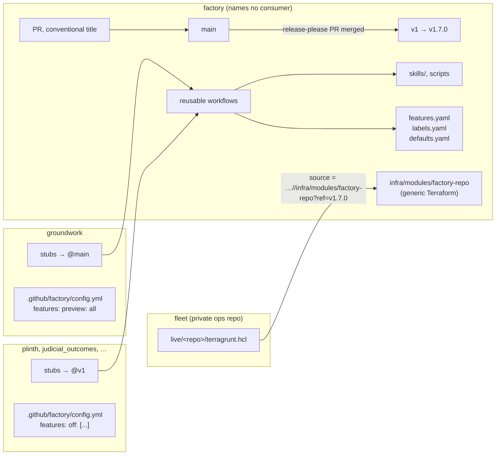

# Rolling out factory changes

Status: proposal, second draft. Nothing here is built yet. The draft takes in an independent review of the first draft and two added requirements: the factory names no other repository, and repositories track the latest release while new behavior arrives behind flags they can opt out of.

## The problem

A factory change reaches a repository only when someone reruns `install-factory.sh` in a clone of it, commits the result and merges it. With four repositories that is four reinstalls and four PRs per change. Of the 11 commits since the first release, 9 changed workflow templates, 2 changed skills and 4 changed infra variables. Each copy is pinned to whatever factory commit it was last installed from, and nothing notices when it falls behind. A change goes everywhere at once or nowhere.

## Requirements

1. **One merge, then a release, reaches every repository.** No PR in each repository for ordinary changes.
2. **groundwork goes first.** It runs changes before the other repositories get them.
3. **The factory names no other repository.** Dependencies point one way: repositories depend on the factory, and the factory depends on none of them. It holds no registry, no per-repository settings, no infra for specific repositories and no repository names in its docs.
4. **Repositories track the latest release by default, with new behavior behind flags.** A change that does something new arrives behind a named flag. It's announced before it turns on, and a repository can turn it off.
5. **Repository-specific knowledge stays in the repository.** That means `FACTORY.md`, the repository's settings, `review-pr-local`, `setup.sh` and its own skills.

## The pattern's downsides, and what this design does about them

Moving shared code into a central repository that every other repository calls has real costs. They are listed first so the design can be judged against them.

| Downside | Severity | Mitigation in this design |
|---|---|---|
| **One control plane.** Whatever `v1` points to runs with every repository's secrets, including `FACTORY_GITHUB_TOKEN`, which can write to all of them. In `factory-local`, it runs on your machine. Today a bad factory commit stays put until someone reinstalls; with this design it reaches every repository on the next run. | Critical | Rulesets on the factory's `main` and `v*` tags (§9). Agents' tokens never cover the factory. Explicit secrets instead of `secrets: inherit` (§1). The local deny list blocks tag pushes, and the local runner runs as a dedicated user (§9). |
| **Behavior changes without a PR in the repository.** Nothing in the consuming repository shows what changed. | High | Classification, flags and announcements (§6). The job summary names the factory commit and the flags that are on (§3). |
| **Jobs in one run could see different factory versions.** A tag moved mid-run could give the review agent and the publish job different code. | High | Each run resolves the called workflow's commit once and uses it for every job (§3). |
| **Interactive sessions lose the skills.** A `/triage 12` in a groundwork session no longer finds skills that aren't committed. | Medium | A SessionStart hook copies the pinned skills in (§4). |
| **The permission ceiling lives in the stub.** A stage that needs a new permission, trigger or input needs a stub change in every repository. | Medium | Such a change is classified as breaking (`feat!`). It ships as a major version, and each repository adopts it when it updates (§2, §6). |
| **Hard to debug.** A repository shows only its stub, and actionlint there can't see inside the called workflow. | Medium | The job summary names the commit, the resolved config and the flags. The factory's CI lints the reusable workflows. |
| **Canary doesn't cover everything.** groundwork never exercises the library-release or dependency-bump paths. | Medium | Run `factory try` against plinth for changes to those paths (§7). |
| **Rollback doesn't undo side effects.** Labels, comments and PRs a bad version created stay. | Low | Accepted. Keep write steps in separate jobs that are easy to audit, as review does today. |
| **One bad change, such as a dispatch loop, hits every repository's bill at once.** | Low | `--max-turns`, job timeouts and concurrency groups already bound it. groundwork running first catches most of it. |
| **GitHub behavior not yet verified.** See Open questions. | ? | Prove each on groundwork in phase 1 before any other repository moves. |

## Design



### 1. Reusable workflows called by small stubs

Workflow logic moves into this repository's `.github/workflows/` as reusable workflows (`on: workflow_call`). Each consuming repository keeps one generated stub per stage. A stub holds only what has to live in that repository: the triggers, concurrency, the permission ceiling, the secrets it passes, and the version it calls.

```yaml
# .github/workflows/factory-review.yml: generated by `factory install`; edit .github/factory/config.yml instead
name: "Factory: review"
on:
  pull_request_target:
    types: [opened, synchronize, reopened, ready_for_review]
  workflow_dispatch:
    inputs:
      pr_number: { description: Pull request number to review, required: true, type: number }
      dry_run: { description: Don't post the review, type: boolean, default: false }
concurrency:
  group: factory-review-${{ inputs.pr_number || github.event.pull_request.number }}
  cancel-in-progress: true
jobs:
  review:
    uses: spdolan/factory/.github/workflows/review.yml@v1
    with:
      pr_number: ${{ inputs.pr_number || github.event.pull_request.number }}
      dry_run: ${{ inputs.dry_run || false }}
    permissions:
      contents: read
      pull-requests: write
      id-token: write          # only to read the called workflow's own commit (§3)
    secrets:
      CLAUDE_CODE_OAUTH_TOKEN: ${{ secrets.CLAUDE_CODE_OAUTH_TOKEN }}
      ANTHROPIC_API_KEY: ${{ secrets.ANTHROPIC_API_KEY }}
```

- **Secrets are passed by name, not with `secrets: inherit`.** Each stage gets only what it uses.
- **One level of nesting.** A stub calls one reusable workflow, which calls none, so GitHub's depth and count limits never come into play.
- **`notify-consumers` is called directly.** A library's release-please workflow calls `spdolan/factory/.github/workflows/notify-consumers.yml@v1`. The consumer list stays in the library's own `FACTORY.md`, as it is today.

### 2. Versions and releases

- **Conventional PR titles.** The factory uses release-please, as plinth does. `fix:` cuts a patch release, `feat:` a minor and `feat!:` a major. §6 says exactly which changes go in which class.
- **Merging the release-please PR is the promotion.** It creates `v1.7.0` and moves `v1`. Until then, merged work sits on `main`, and only repositories that track `main` run it. That gap gives groundwork a soak period for free.
- **Each repository picks its ref.** Everything here is chosen in the repository, so the factory knows nothing about who tracks what:

  | Ref in the stub | Gets | Use for |
  |---|---|---|
  | `@main` | every merge | groundwork, the test repository |
  | `@v1` (default) | every release until v2 | everyone else |
  | `@v1.7.0` | that release only | freezing a repository; Dependabot can bump it (unverified for private repositories) |

- **Rollback** is a revert PR plus a release. In an emergency, move `v1` back to the previous tag by hand. The tag ruleset allows that for the owner only.

### 3. One commit per run, and a run that says what it ran

Every reusable workflow's first job finds the commit it was called at and passes it to each later job as an output. Every job then checks out the factory at exactly that commit:

- The commit comes from GitHub's own record of the called workflow, `job_workflow_sha`. That value is in the OIDC token, which is why the stub grants `id-token: write`. It may also be available as a workflow context; that is unverified. The stub doesn't repeat the ref, so a stub can't call one version and fetch another.
- The first step is `uses: ./.factory/.github/actions/prepare`. It is a local path inside that checkout, so the action is the same version as the workflow.
- `prepare` writes the job summary: the factory commit and release, the resolved config with where each value came from, the flags that are on, and any pending announcements (§6).

Fetching the factory: if this repository is public, checkout needs no token. If it stays private, each repository needs a read-only `FACTORY_READ_TOKEN` scoped to the factory alone. That is one more token to rotate, and if it expires every repository stops at once. Decision 1 below covers this.

### 4. Skills and scripts come from the pinned commit

- **CI.** `prepare` copies `.factory/skills/<name>` into `.claude/skills/<name>`, so every existing prompt path and script path keeps working. The consuming repository gitignores the factory-managed skill directories and `.factory/`, so an agent's `git add -A` can't commit them.
- **Overrides.** A factory skill the repository has committed (`git ls-files .claude/skills/<name>`) is the repository's own fork. `prepare` leaves it alone and says so in the summary. Repository-owned skills such as `review-pr-local` and `onboard-city` aren't touched.
- **Interactive sessions and `factory-local`.** `factory install` adds a SessionStart hook to the repository's `.claude/settings.json`. The hook reads the ref from a stub and copies that version's skills in. It downloads the tarball from the factory: anonymously if the factory is public, or with `gh` if it is private. It does nothing if the skills are already current. Local sessions, claude.ai sessions and `factory-local` worktrees then see the same skills as CI, so no plugin is needed.
- **The improve-review loop writes only `review-pr-local`.** Core `review-pr` is no longer in the repository. If a lesson looks portable, the loop says so in its PR, and you port it to the factory. This is a phase 0 change.

### 5. Each repository's settings live in that repository

Each repository has a committed `.github/factory/config.yml`:

```yaml
# groundwork/.github/factory/config.yml
verify: true
local:
  setting_sources: user,project,local
features:
  preview: all        # try every preview flag here first
```

```yaml
# plinth/.github/factory/config.yml
autonomy: small
effort: { triage: high }
features:
  off: [spec-auto-advance]
```

- **Precedence**, highest first:
  1. A repository Actions variable, for example `FACTORY_AUTONOMY=off`. It is the kill switch, and agents can't change it because their token has no Variables permission.
  2. `config.yml`.
  3. The factory's `defaults.yaml`.
- **Where it's read from.** `prepare` reads `config.yml` from the repository's own checkout. For `pull_request_target`, that is the default branch, so a PR can't change the config its own review uses.
- **Protection.** List `config.yml` under Protected paths in `FACTORY.md`.
- **The current variables.** The `FACTORY_MODEL_*` and `FACTORY_EFFORT_*` variables still work as overrides during migration. After that, they stay only for emergencies.

### 6. New behavior: classes, flags and announcements

**Every factory PR title declares its class:**

| Class | Means | Release | Reaches repositories |
|---|---|---|---|
| `fix:`, `chore:`, `docs:` | Brings behavior back to what is documented. No new GitHub writes, tools, permissions, triggers, labels, outputs or defaults. | patch | on the next release, everywhere |
| `feat:` | Any new effect a repository could notice: a new write action, tool or MCP server, a new instruction to the agent, more model calls or cost, a changed default model or effort, a new stage. | minor | **behind a flag** |
| `feat!:` | Changes what a repository must provide or rely on: `workflow_call` inputs, secrets or permission ceiling, triggers, job IDs, artifact names, paths the repository owns (`FACTORY.md` sections, `review-pr-local`, `setup.sh`), labels, the `config.yml` schema. Also locking a flag (see the lifecycle below). | major | only when the repository moves to `@v2` |

Commit af9f982 shows why this matters. It was titled `fix(local)`, but it changed the default `FACTORY_LOCAL_SETTING_SOURCES` to `project,local`, which silently took user-level skills such as gstack `/browse` away from repositories that hadn't set the variable. Under these rules it is a `feat`, behind a flag, with an announcement.

PR #11, which renames job display names, is a `chore:`. Display names aren't part of the contract, but job IDs are. The release notes should mention it, because a ruleset that requires a check by name would need updating.

**Flags are declared in `features.yaml`**, which names no repository:

```yaml
spec-auto-advance:
  summary: Agents may start the spec stage for medium ready-to-spec issues without approval.
  stages: [triage]
  state: default            # preview | default | locked
  added: 1.7.0
  default_from: 1.8.0       # turns on for everyone not opted out when 1.8.0 is released
  retire_after: 2.0.0
  cost: none                # or: "+1 Sonnet call per issue"
```

**Gating.**
- `prepare` resolves the flags (defaults from `features.yaml`, then `config.yml` `features.on`, `off` and `preview`, then a variable override) and outputs them as JSON.
- Workflow steps use `if: contains(fromJSON(needs.setup.outputs.flags), 'spec-auto-advance')`.
- New skill behavior lives in `skills/<skill>/features/<flag>.md`. That file is copied in, and named in the prompt, only when the flag is on, so a skill's base text never changes behind a flag.

**Lifecycle.**
1. `preview`: off unless a repository opts in. groundwork's `preview: all` runs it first.
2. `default`: announced in one release and on from `default_from` unless the repository opted out. This is the opt-out window. A flag turns on only when a release happens, never on a date.
3. `locked`: the opt-out is gone. That removes a choice, so it is a `feat!` and waits for the next major.
4. Retired: the flag and the old code path are deleted.

**Announcements reach the repository.**
- Release notes come from the `features.yaml` diff, with sections for new preview flags, flags turning on in the next release, and locked flags.
- The weekly `housekeeping` stage (a stub in each repository, with `issues: write`) opens or updates one issue per repository, labeled `factory:notice`. It lists each flag that will turn on soon and that the repository hasn't decided on, with its summary, cost, the release it turns on in, and the one-line opt-out. It closes when every flag is decided or on. The same stage reports a newer major version and re-creates missing labels from `labels.yaml`.
- `prepare` adds `::warning::` lines when `config.yml` names an unknown or locked flag, or opts out of a flag that is close to `retire_after`.

**The factory's CI enforces the classes.**
1. The PR title must follow conventional commits.
2. `contract.lock` is generated from the reusable workflows. It records their inputs, secrets, outputs, job IDs, permissions, `--allowedTools` strings and triggers, plus `defaults.yaml` and `labels.yaml`. A diff that does more than add an optional input needs `!`. A change to allowedTools, permissions, write steps or defaults fails under `fix:`.
3. The `features.yaml` lint: every flag used is declared, every declared flag is used, and a flag past `retire_after` fails the build.
4. Factory PRs also get `review-pr`, with a rubric for whether the title's class is right. It is advisory.

### 7. Trying a branch before it merges

`factory try`, run from inside the consuming repository with your own `gh` login:

```bash
cd ~/code/groundwork && factory try review 42 --ref my-branch
```

1. It pushes a throwaway branch, `factory-try/my-branch`, whose stubs call `@my-branch`.
2. It runs `gh workflow run factory-review.yml --ref factory-try/my-branch -f pr_number=42 -f dry_run=true`.
3. It prints the run URL. `--cleanup` deletes the branch afterwards.

What `dry_run` covers:
- **Triage and review.** They already put the agent and the writes in separate jobs, so `dry_run` skips the write job and prints what it would have posted.
- **Implement and spec.** The agent pushes for itself. Under `dry_run` it gets a read-only `github.token` instead of `FACTORY_GITHUB_TOKEN`, and the diff is uploaded as an artifact. Without `dry_run`, use a throwaway issue.

`try` runs a branch of the factory with that repository's secrets, so only run branches you wrote.

### 8. Infra lives outside the factory

- The factory keeps only the generic Terraform module, `infra/modules/factory-repo`. It covers Actions secrets, labels, Actions permissions, the default-branch ruleset and, while the factory is private, the access setting.
- `infra/live/` moves to a new private repository, for example `spdolan/fleet`, which is the only place that lists your repositories. Its Terragrunt configs pull the module with `source = "git::https://github.com/spdolan/factory.git//infra/modules/factory-repo?ref=v1.7.0"`.
- `fleet` depends on the factory and on the consuming repositories; the factory depends on neither. Applying works as today: one admin token and `terragrunt run --all apply`.
- Model, effort and autonomy settings leave Terraform and move into each repository's `config.yml`. What stays in Terraform changes rarely.

Labels no longer need infra to exist. The workflows already create missing labels with `gh label create --force`. `labels.yaml` becomes the single source for that, for the module and for `factory install`, replacing today's three copies.

**Enforcement.** The factory's CI fails on any `owner/repo` reference other than the factory itself, and on any `infra/live/` directory. Docs and examples use placeholders (`owner/library`, `@owner/library`). The README's plinth and judicial_outcomes notes move to `fleet` or to those repositories' own `config.yml` comments. The novelty-audit skills stop being vendored by the installer; a repository that wants them in CI commits them itself, and the novelty gate looks for them by skill name.

### 9. Protecting the factory

Requirement 1 makes the factory the most powerful repository you own, so it needs these:

- **Rulesets.**
  - On `main`: require a PR and the CI check, and block force pushes.
  - On `refs/tags/v*`: only the release workflow and the owner may create or move them.
  - On a private repository these need GitHub Pro; on a public one they're free.
- **No agent token covers the factory.** `FACTORY_GITHUB_TOKEN`'s repository list never includes it.
- **The `factory-local` deny list** also blocks pushing tags (`git push … refs/tags/…`, `git push --tags`). The self-hosted runner runs as a dedicated macOS user without your personal `gh` login. Until that is in place, run local sessions only in repositories pinned to a release, not `@main`.

### 10. One command-line tool, scoped to the repository it runs in

`scripts/install-factory.sh` becomes `factory`. Every command works on the repository you run it in:

| Command | Does |
|---|---|
| `factory install` | first setup: stubs at `@v1`, `.gitignore` block, SessionStart hook, `config.yml`, `FACTORY.md`, `vision.md`, `bets.md` |
| `factory update` | regenerates stubs for the major version named in `config.yml` (`factory: v2`) and shows the diff; used when the repository adopts a breaking release |
| `factory try …` | §7 |
| `factory doctor` | checks that the secrets, labels, config schema and stubs match the version the stubs call |
| `factory materialize` | what the SessionStart hook runs; can also be run by hand |

## What this draft dropped from the first

- **Release channels and a promote workflow.** release-please releases and the `@main`/`@v1` choice cover them.
- **`fleet.yaml`, `factory-sync.yml`, `FACTORY_SYNC_TOKEN` and fleet-wide `status`.** They broke requirement 3, and the sync token would have been the most powerful credential in the system.
- **`factory_ref` as a stub input.** It is replaced by the commit the run resolves for itself.
- **A Claude Code plugin marketplace.** The SessionStart hook covers it.
- **A GitHub App.** Reconsider when token rotation starts to hurt.

## Credentials

| Secret | Where | Scope |
|---|---|---|
| `FACTORY_GITHUB_TOKEN` | each repository | unchanged; never includes the factory |
| `CLAUDE_CODE_OAUTH_TOKEN` or `ANTHROPIC_API_KEY` | each repository | unchanged |
| `FACTORY_READ_TOKEN` | each repository, **only if the factory stays private** | the factory only, Contents: read |

## Migration

**Phase 0: hygiene.** Small PRs, none of them depending on the rest.
1. Create `fleet` and move `infra/live/` into it. Replace repository names in the factory's docs and examples with placeholders. Add the CI guard against `owner/repo` references.
2. Point improve-review-pr at `review-pr-local` only.
3. Add the tag-push denies to `factory-local`. Add rulesets on the factory.
4. Add the PR-title lint and adopt release-please. Cut `v1.0.0` from the current `main`.

**Phase 1: groundwork on `@main`.**
1. Add the reusable workflows, `prepare`, `defaults.yaml`, `labels.yaml`, `features.yaml`, `contract.lock`, the `config.yml` schema and the `factory` CLI. Build the workflows as the generic plan → agent → apply stage runner driven by `pipeline.yaml` ([pipeline.md](pipeline.md)), so they're rewritten once, not twice. `defaults.yaml` and `labels.yaml` fold into `pipeline.yaml` there.
2. Run `factory install` in groundwork. That replaces its vendored copies with stubs at `@main`, adds `config.yml` with `preview: all`, and adds the hook.
3. Answer the open questions below, using `try` runs and groundwork's real traffic.
4. Exit when triage, review, implement, local and housekeeping have each run green from `@main`, an interactive session finds the skills, and a test flag has gone from preview to default with its `factory:notice` issue.

**Phase 2: everyone else on `@v1`.**
1. Run `factory install` in plinth, judicial_outcomes and novelty_audit. That is one PR each, and the last manual reinstall.
2. Move their settings from Terraform variables into `config.yml`.
3. Delete `templates/github/workflows/` and the installer's copy mode.

## Decisions for you

1. **Make the factory public?** Requirement 3 removes the main reason to keep it private, since it would no longer name your repositories.
   - Going public removes `FACTORY_READ_TOKEN` and the access setting, along with the risk that the read token expires and stops every repository at once. It makes tag and branch rulesets free, lets Dependabot bump pinned versions, and lets the SessionStart hook fetch skills without credentials.
   - The cost is that your prompts and workflows are visible.
   - Recommended: public.
2. **Breaking-change cadence.** Should a major version wait until several breaking changes have accumulated? Recommended: yes. Mark single `feat!` PRs as such and release them together.

## Open questions to prove in phase 1

None of these could be checked against GitHub's documentation while this was written. Each has a fallback.

1. **Called workflows and caller variables.** Do `vars` in a called workflow resolve to the caller's repository variables? If not, the stub passes the kill-switch variables as inputs.
2. **Sharing reusable workflows from a personal account.** Can a private repository on a personal account share reusable workflows with the owner's other private repositories (the Settings → Actions → Access setting)? If not, make the factory public. That is decision 1.
3. **Finding the called workflow's commit.** Is `job_workflow_sha` available as a context, or only in the OIDC token? If neither works, the stub passes `factory_ref` again, and the first job resolves it to a commit once.
4. **Dependabot and private reusable workflows.** Does Dependabot bump `@v1.x.y` pins on reusable workflows from a private repository? If not, a pinned repository runs `factory update` itself.
5. **Check names.** Called jobs appear as `<stub job> / <called job name>`. Any required check has to be renamed once.
